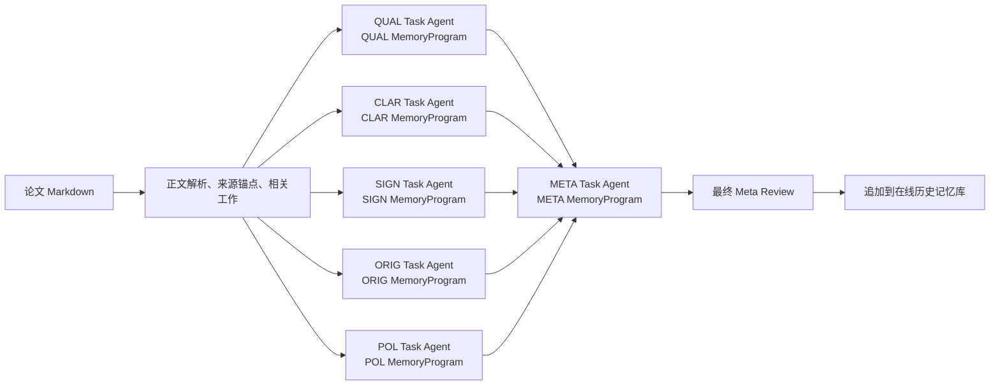
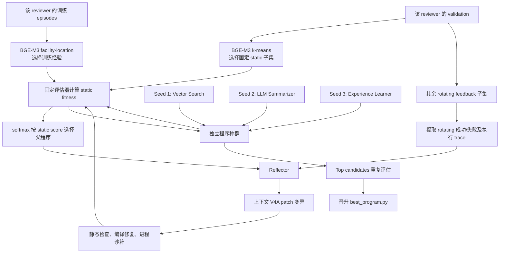
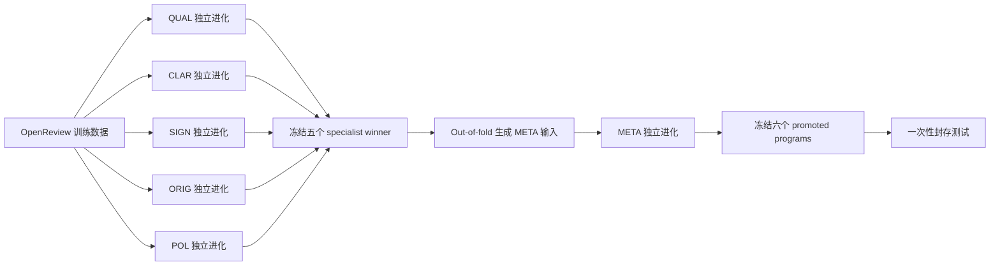

# AgentReview M★ 自进化审稿系统阶段汇报

> 汇报日期：2026-07-23  
> 项目目录：`/data0/xyj/shengao/AgentReview_0722/AgentReview`
>
> **⚠️ 历史归档**：本文写于上一代快照（0722），其中协议数字（20 iterations / 5 seeds / 250 validation families）与数据面（OpenReview train_clean/test）均为旧口径，已被 ADR-0006/0007 与《[AgentReview M★ 代码架构全景解析（2026-08-20 版）](../AgentReview%20M★%20代码架构全景解析.md)》取代，仅作历史汇报存档。

## 1. 一页结论

本项目的目标不是增加一个额外的 review harness，而是将 M★ 的
“任务专属可执行 MemoryProgram 自进化”直接应用到 AgentReview 审稿流程。

当前已经完成：

- 固定五个 reviewer 的人物设定、23 个子维度及五 specialist 后接 META 的拓扑；
- 将 QUAL、CLAR、SIGN、ORIG、POL、META 映射为六个相互独立的 M★ 任务；
- 实现 MemoryProgram 的三类可进化对象：Schema、write/read Logic、Instructions；
- 实现三种初始程序、种群搜索、Reflector 变异、静态/动态验证集和候选晋升；
- 实现 OpenReview 人类审稿数据适配、work-family 级数据隔离和封存测试入口；
- 接入 CoCoReviewBench 的 ReviewSplit/ReviewClassify，作为分类器和指标设计参考；
- 接入冻结版本的 BGE-M3，用于正式实验的样本选择；
- 实现候选代码沙箱、资源限制、版本哈希和实验溯源；
- 完成第一轮 QUAL smoke，验证了一次完整的父程序选择、反思变异和候选晋升；
- 35 个自动化测试全部通过。

当前尚未完成：

- 五个 specialist 和 META 的端到端 smoke 尚未完成；
- 冻结 Semantic Scholar 缓存尚未准备；
- 正式 CoCo 分类服务和 BGE-M3 版本尚未进入完整实验；
- 尚未完成 5 seeds × 20 iterations 的正式进化；
- 尚未执行封存测试集，因此目前没有“自进化显著有效”的实验结论。

因此，当前可以准确表述为：

> 已完成面向 AgentReview 的 M★ 自进化架构实现和实验协议建设，
> 正在进入小规模运行验证阶段；当前还不能把工程测试分数当作正式进化效果。

---

## 2. 研究目标与边界

### 2.1 研究问题

在保持审稿标准和 reviewer 分工不变的前提下，是否可以让每个 reviewer
通过任务专属的可执行记忆程序，独立学习“应该记录什么、如何组织历史经验、
如何检索经验以及如何把经验交给审稿 Agent”，从而提高审稿的完整性、
正确性、可验证性和最终决策质量？

### 2.2 严格不变的部分

以下内容不是搜索对象：

- 五个 reviewer 的人物设定及其 23 个子维度；
- QUAL、CLAR、SIGN、ORIG、POL 五 specialist 后接 META 的拓扑；
- Task Agent；
- 评估器和人类参考答案；
- 基础模型权重；
- 当前论文的正文、检索材料及输出格式约束。

五个 reviewer 的唯一来源为 `REVIEW_Request.md`，运行时校验 SHA-256：

```text
609eb9308b21b327716e0ae4ed60697be4922f3c829a7def2ea8d2ff0e7cbe42
```

### 2.3 真正参与进化的部分

每个任务只进化一个可执行 `MemoryProgram`：

1. **Schema**：历史经验以什么字段和结构存储；
2. **Write Logic**：如何从历史论文和人类审稿中提取、压缩和写入经验；
3. **Read Logic**：如何根据当前论文检索、排序和组合经验；
4. **Instructions**：如何解释知识条目、查询和返回给 Task Agent 的上下文。

六个任务拥有独立的数据、种群、得分、变异轨迹和最终程序。任何 reviewer
都不会接收其他 specialist 的搜索反馈，只有 META 能读取五份已经完成的
specialist review。

---

## 3. 系统总体架构

### 3.1 在线审稿流程



关键约束：

- 五个 specialist 相互独立，可以并行运行；
- specialist 看不到其他 reviewer 的结果；
- META 是唯一聚合五份 specialist review 的节点；
- 在线运行可以追加已经完成的审稿经验；
- 可执行 MemoryProgram 只能通过新的离线 M★ 搜索更新，不能在线自行改代码。

### 3.2 单个 reviewer 的离线 M★ 进化



正式搜索默认参数与 M★ 实验协议保持一致：

| 项目 | 当前正式默认值 |
|---|---:|
| 初始 MemoryProgram | 3 |
| 变异轮数 | 20 |
| static validation | 25 |
| rotating feedback | 5 |
| train-to-validation budget | 5:1 |
| parent softmax temperature | 0.15 |
| 编译修复上限 | 3 |
| top candidate 重复评估 | 3 次 |
| 独立实验 seeds | 5 |
| 预先指定的主 seed | 0 |

static 样本只用于稳定评分，不进入 Reflector；Reflector 只能看到 rotating
样本中的有限成功/失败案例、执行 trace、父程序 lineage 和少量种群参考程序，
从而避免针对固定验证集直接修改代码。

### 3.3 六任务的进化顺序



META 必须在五个 specialist 完成并冻结后才能开始。META 训练输入采用
out-of-fold 生成，当前论文的人类目标不能进入生成该论文 specialist 输出时
使用的记忆。

---

## 4. 数据与评估设计

### 4.1 数据来源

- `OpenReview/train_clean.jsonl`：进化训练和验证数据，包含人类审稿目标；
- `OpenReview/test.jsonl`：封存测试集；
- 论文 Markdown：提供当前论文正文和可验证的来源锚点；
- Semantic Scholar 冻结缓存：提供可复现的相关工作，正式实验禁止实时变化；
- CoCoReviewBench：只提供 ReviewSplit、ReviewClassify、意见类别体系及指标设计参考。

CoCoReviewBench 不是第二套自进化架构，也不改变 M★ 的搜索过程。

### 4.2 防止数据泄漏

数据不是按 JSONL 行随机切分，而是先形成 work family：

```text
共享 paperhash OR 共享 normalized title
```

上述关系取传递闭包，同一论文的不同版本必须属于同一个 family。数据准备过程：

1. 从 `test.jsonl` 建立封存 test family 集合；
2. 从训练候选中删除所有与 test 重叠的 family；
3. 划分 train、specialist validation、meta validation；
4. 保证三个集合在 family 层面互斥；
5. 正式实验记录数据 manifest 和外部缓存哈希。

test 不参与搜索、prompt 调整、seed 选择或失败案例反馈。

### 4.3 Specialist 指标

固定 Judge 为每份 specialist review 计算五项 1–5 分：

- alignment / correctness；
- completeness / thoroughness；
- grounding；
- verifiability；
- clarity。

五项均值归一化到 `[0,1]`。CoCo 的冻结 ReviewSplit/ReviewClassify
从生成文本中重新提取意见类别，不信任候选自己声明的类别字段。

类别覆盖率为：

```text
|AI categories ∩ human categories| / |human categories|
```

最终 specialist fitness 是质量分和类别覆盖率的调和平均。

### 4.4 META 指标

META fitness 是以下三组指标的调和平均：

- 裁决清晰度、grounding、verifiability、冲突覆盖；
- 与人类 meta-review 的 alignment 和 completeness；
- 总体 calibration 和 decision consistency。

### 4.5 如何证明“进化有效”

正式实验必须在相同数据切分、模型、Judge、CoCo revision、BGE revision 和
Semantic Scholar 缓存下比较：

| 系统 | 作用 |
|---|---|
| 完整 M★ | 主实验 |
| `iterations=0` | 三个初始程序、无进化基线 |
| `mutation_scope=instructions_only` | 只进化外围 instructions |
| `mutation_scope=schema_logic` | 只进化记忆结构和读写逻辑 |
| `parent_policy=best` | 无种群采样、线性最优父程序 |
| `memory_mode=none` | 无历史记忆基线 |
| AgentReview 0716 | 原系统外部基线 |

报告内容：

- 当前最小可行闭环报告 outer seed 0 的 paired improvement；未来可选的
  stability/robustness 实验才报告多个 outer seeds 的 mean ± standard deviation；
- 相对于无进化基线的 paired improvement；
- work-family 级 paired bootstrap 95% confidence interval；
- 改善和下降的论文比例；
- 格式失败率、候选编译失败率、API 调用量和运行时间；
- META 作为主要终点，五个 specialist 作为机制和分维度结果。

outer seed 0 是当前最小可行闭环的预先确定运行。seed 1–4 仅是未来可选的
稳定性分析配置，不能根据验证分数挑选最好的 seed 再测试。每个 outer seed
内部仍包含三条独立 Seed Program lineage，不得混淆。

---

## 5. 当前实际进度

### 5.1 已完成的工程工作

| 模块 | 状态 | 说明 |
|---|---|---|
| 固定 reviewer 定义 | 已完成 | 唯一文件及运行时 SHA-256 校验 |
| 单一 M★ 架构 | 已完成 | 已清除额外 `review_harness` 路径 |
| 六任务独立池 | 已完成 | QUAL/CLAR/SIGN/ORIG/POL/META 相互独立 |
| 三个初始程序 | 已完成 | Vector、Summarizer、Experience |
| M★ 种群搜索 | 已完成 | static、rotating、softmax parent、20 轮协议 |
| Reflector 变异 | 已完成 | 上下文 V4A patch 和最多三次修复 |
| 数据隔离 | 已完成 | family 划分、test 排除、META 独立验证 |
| Specialist 指标 | 已完成 | Judge 质量分 + CoCo 类别 recall |
| META 指标 | 已完成 | 三组分数调和平均 |
| CoCo adapter | 已完成 | 固定本地仓库版本和官方 prompt/parser |
| BGE-M3 adapter | 已完成 | 正式样本选择要求不可变 revision |
| 候选沙箱 | 已完成 | bubblewrap、清空环境、资源限制、能力接口 |
| 封存测试命令 | 已完成 | 六任务只执行一次且拒绝覆盖报告 |
| 自动化测试 | 已完成 | 35/35 通过 |

### 5.2 已准备的小样本数据

`data/pilot/manifest.json` 的实际状态：

| 项目 | 实际值 |
|---|---:|
| train families | 30 |
| specialist validation families | 6 |
| meta validation families | 6 |
| test families | 3890 |
| family overlap | 0 |
| test overlap removed | true |
| 缺失 Markdown | 5 |
| Semantic Scholar cache | 尚未提供 |
| formal_ready | false |

不同维度实际可用数据量：

| Reviewer | episodes | validation |
|---|---:|---:|
| QUAL | 26 | 5 |
| CLAR | 26 | 5 |
| SIGN | 24 | 5 |
| ORIG | 25 | 5 |
| POL | 11 | 1 |

这里暴露出一个小样本问题：POL 的有效验证样本只有 1 个，不适合用来判断
进化效果。原因不是数据泄漏，而是小样本中可用于该维度的人类目标较少，
同时有 5 篇论文缺失可解析 Markdown。下一版 pilot 应扩大 family 数量。

### 5.3 第一轮 QUAL smoke：已完成

`runs/pilot_qual` 已形成完整闭环：

1. 三个初始 MemoryProgram 均通过质量门并完成 static 评分；
2. `Experience Learner` 被采样为父程序；
3. rotating 案例及执行 trace 被交给 Reflector；
4. Reflector 生成 `program_003_child.py`；
5. child 无需编译修复即通过静态检查、编译、smoke 和沙箱执行；
6. child 完成 static 评估并被晋升为 `best_program.py`；
7. `best_eval_report.json` 明确记录 `test_set_used=false`。

本轮得分：

| Program | static score |
|---|---:|
| Vector Search | 0.9681 |
| LLM Summarizer | 0.9583 |
| Experience Learner（parent） | 0.9473 |
| Evolved child | 0.9690 |

child 相对 parent 的单次 static 分数提高约 `0.0217`，但相对原有最佳
Vector seed 只提高约 `0.0009`。而且 child 的 selection repeat 为 `0.9357`，
最后一次 static 复评为 `0.9473`，明显低于其最初的 `0.9690`。

本次变异确实修改了允许搜索的对象：

- 为记忆 Schema 增加 reviewer signal 字段；
- 从历史人类审稿中提取 baseline、ablation、scalability、metric 等信号；
- 在 read 阶段返回这些信号；
- 增加 graph cold-start/link-prediction 的 QUAL 检查清单。

它没有修改五个 reviewer 的固定人物设定。这说明“可执行 MemoryProgram
自进化机制”已经真实运行，而不是只进行了 prompt 调用或静态检索。

但是，该 checklist 明显针对唯一 rotating 案例的 graph cold-start 主题，
再加上本轮只有 2 个 static 样本和 1 个 rotating 样本，复评分数波动较大。
所以本轮只能证明工程闭环成立，不能证明 child 比初始程序更好，也不能证明
系统已经获得稳定的审稿进化能力。

---

## 6. 接下来的操作

### 阶段 A：重建可用的小样本 pilot

目标：保证每个 reviewer 至少有足够的 smoke validation，尤其是 POL。

建议新建 `data/pilot_v2`，不覆盖现有诊断产物：

```bash
cd /data0/xyj/shengao/AgentReview_0722/AgentReview
PY=/data0/xyj/miniconda3/envs/env_shengao/bin/python

$PY -m memory_evolution.cli prepare-specialists \
  --openreview-root /data0/xyj/shengao/OpenReview \
  --output-dir data/pilot_v2 \
  --max-train-families 80 \
  --validation-families 15 \
  --meta-validation-families 15 \
  --max-paper-chars 12000 \
  --seed 0
```

完成标准：

- `family_overlap=0`；
- `test_overlap_removed=true`；
- 每个 specialist 至少有 2 个 validation，建议达到 5 个以上；
- 记录各维度的实际 episode/validation 数，而不是只记录请求的 family 数。

### 阶段 B：QUAL smoke 已通过，不重复消耗

现有 `runs/pilot_qual` 已满足单任务 smoke 的工程验收条件，不需要在同一批
数据上反复重跑。重跑只会增加随机样本和 API 消耗，不能把 smoke 变成正式
效果实验。

下一步应在扩充后的 `pilot_v2` 上直接执行五 specialist + META 的端到端
smoke。该 suite 会自然地再次覆盖 QUAL，并检查其他五个独立进化任务。

### 阶段 C：六任务端到端 smoke

```bash
$PY -m memory_evolution.cli evolve-specialists \
  --data-root data/pilot_v2 \
  --output runs/pilot_v2_suite \
  --experiment-seeds 0 \
  --primary-seed 0 \
  --smoke

$PY -m memory_evolution.cli cache-meta-inputs \
  --data-root data/pilot_v2 \
  --program-root runs/pilot_v2_suite \
  --output data/pilot_v2/meta_inputs.jsonl \
  --folds 2 \
  --smoke

$PY -m memory_evolution.cli prepare-meta \
  --openreview-root /data0/xyj/shengao/OpenReview \
  --specialist-outputs data/pilot_v2/meta_inputs.jsonl \
  --output-dir data/pilot_v2

$PY -m memory_evolution.cli evolve-meta \
  --data-root data/pilot_v2 \
  --output runs/pilot_v2_suite \
  --experiment-seeds 0 \
  --primary-seed 0 \
  --smoke
```

完成标准是产生六个独立的 promoted program：

```text
runs/pilot_v2_suite/
  QUAL/best_program.py
  CLAR/best_program.py
  SIGN/best_program.py
  ORIG/best_program.py
  POL/best_program.py
  META/best_program.py
```

### 阶段 D：冻结正式实验基础设施

需要固定并记录：

1. Semantic Scholar 完整缓存及 SHA-256；
2. CoCoReviewBench 本地 commit；
3. ReviewSplit checkpoint revision；
4. ReviewClassify checkpoint revision；
5. BGE-M3 immutable revision；
6. Task、Reflector、Judge 模型名称；
7. reviewer prompt SHA-256；
8. 数据 manifest SHA-256。

先运行不带 S2 cache 的正式数据准备，读取 manifest 中的
`semantic_scholar_missing_ids`；完成全部 ID 的离线检索后，以相同参数重新
准备数据。检索成功但没有相关工作的论文也必须在缓存中保留空列表，不能缺项。

### 阶段 E：正式进化

建议正式规模：

| 数据/搜索项目 | 规模 |
|---|---:|
| train candidate families | 2000 |
| specialist validation families | 250 |
| meta validation families | 250 |
| experiment seeds | 0（当前 minimal feasibility；0,1,2,3,4 仅供未来 stability） |
| mutations per seed/task | 20 |
| specialist tasks | 5 |
| META tasks | 1 |

执行顺序：

1. 当前 minimal feasibility 仅以 outer seed 0 运行；未来可选 stability 实验
   才扩展到多个 outer seeds；
2. 固定 seed 0 对应的五个 promoted programs；
3. out-of-fold 生成 META 输入；
4. META 若进入后续完整实验，outer seed 数同样参数化且至少为 1；
5. 固定 seed 0 META program；
6. 运行正式消融；
7. 最后才准备并执行一次封存 test suite。

### 阶段 F：大规模效果分析

主要判断标准：

- 完整 M★ 相对于 `iterations=0` 的 META fitness 是否提高；
- 未来 stability 实验再判断提升是否跨多个 outer seeds 稳定；该项不属于
  当前 minimal feasibility 闭环的必要条件；
- 95% paired bootstrap CI 是否支持正向增益；
- 是否存在某个 specialist 明显退化；
- 完整 M★ 是否优于 instructions-only、schema-logic-only 和 linear-best；
- 质量提升是否伴随不可接受的格式失败率或推理成本增加。

只有在上述分析完成后，才能回答“该系统是否真正通过 M★ 实现了有效的审稿
自进化”。

---

## 7. 当前风险与应对

| 风险 | 当前表现 | 应对 |
|---|---|---|
| 小样本类别稀疏 | POL validation 只有 1 | 扩大 pilot family 数并检查实际有效计数 |
| smoke 中断 | QUAL 只完成 2/3 seeds | 使用新输出目录重跑并保留失败诊断 |
| API 成本较高 | 完整搜索调用 Task/Reflector/Judge/CoCo | 先用 QUAL 记录单轮时间和调用量，再外推预算 |
| CoCo 分类成本高 | 每个意见需要 split/classify | 固定服务版本，监控吞吐和失败率 |
| 外部检索漂移 | 尚无冻结 S2 cache | 正式运行前建立完整缓存和哈希 |
| 验证集过拟合 | Reflector 可能利用反馈 | static 不进入反馈，只开放 rotating 的有限 trace |
| 可执行候选风险 | MemoryProgram 会生成代码 | bubblewrap 沙箱、白名单导入、资源限制、无网络 |
| 结果选择偏差 | 可能挑最好 seed | 预注册 seed 0，其他 seeds 只报告稳定性 |
| test 污染 | 反复观察 test | `final-evaluate-suite` 一次执行且拒绝覆盖 |

---

## 8. 本次组会建议汇报口径

建议用以下三句话概括：

1. **架构方面**：已经把 M★ 的任务专属可执行 MemoryProgram 搜索映射到五个
   独立 specialist 和一个 META，且 reviewer 设定、Task Agent、评估器和系统
   拓扑不参与进化。
2. **工程方面**：数据隔离、种群搜索、变异修复、正式分类与 embedding adapter、
   候选沙箱和封存测试协议都已实现，35 个自动化测试通过。
3. **实验方面**：第一轮 QUAL smoke 已完成真实的父程序选择、反思变异、
   重新评估和候选晋升，证明单任务工程闭环成立；但样本过小且复评分数波动
   明显，下一步是完成六任务端到端 smoke，再进行冻结版本下的 5-seed 正式
   实验，当前不宣称已经获得稳定进化增益。

---

## 9. 代码入口

| 内容 | 文件 |
|---|---|
| reviewer 唯一设定 | `REVIEW_Request.md` |
| reviewer hash 与角色构建 | `agentreview/single_paper_review_roles.py` |
| M★ 搜索和种群 | `memory_evolution/search.py` |
| MemoryProgram 协议 | `memory_evolution/program_protocol.py` |
| 三个初始程序 | `memory_evolution/seeds/` |
| Reflector 和修复 | `memory_evolution/reflector.py` |
| OpenReview 数据准备 | `memory_evolution/agentreview_data.py` |
| specialist/META 指标 | `memory_evolution/metrics.py` |
| META out-of-fold 缓存 | `memory_evolution/meta_cache.py` |
| CoCo adapter | `memory_evolution/coco_adapter.py` |
| BGE-M3 adapter | `memory_evolution/embedding_adapter.py` |
| 候选沙箱 | `memory_evolution/sandbox.py` |
| 命令行入口 | `memory_evolution/cli.py` |
| 完整复现协议 | `docs/memory_evolution.md` |
