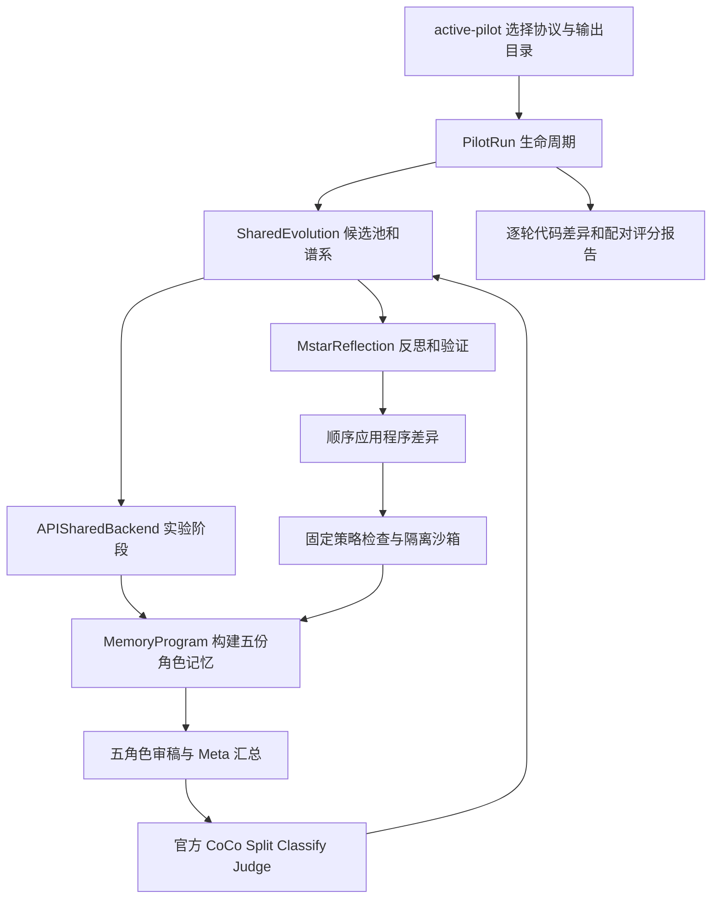

# AgentReview 0930

AgentReview 使用五个固定审稿角色、共享记忆程序和 CoCo 评分完成离线自进化实验。当前代码采用方舟 API 生成评审和反思程序，M★ 负责记忆程序进化，CoCo 负责最终评审评分。

当前实验按用户要求保持 **paused**，本机 CoCo 服务已停止，GPU 0–3 已释放。当前选择文件 [config/active-pilot.json](config/active-pilot.json) 继续指向原有 15 篇、五轮小规模实验，状态见 [pilot-state.json](artifacts/pilot-0930-local/pilot-state.json)，结果见[自进化逐轮报告](artifacts/pilot-0930-local/report/自进化逐轮报告.md)。流式接收与流程计时已适配，新协议处于 prepared，说明见[流式 API 与流程耗时](docs/STREAMING_TIMING_0930.md)。

## 架构



| 位置 | 职责 |
|---|---|
| `deployment/pilot_0930.py` | 显式协议与目录、预检、运行状态、中断处理和报告调度 |
| `deployment/pilot_data.py` | 可复现的数据选取、论文家族隔离和完整正文复制 |
| `AgentReview/agentreview/research_v2/shared_evolution.py` | 父代选择、候选池、轮次、失败归因与冻结 |
| `AgentReview/agentreview/research_v2/shared_experiment.py` | 记忆、审稿、评分与反思阶段的具体实现 |
| `AgentReview/agentreview/research_v2/mstar_adapter.py` | 显式反思、验证、三次修复与过程记录 |
| `AgentReview/agentreview/research_v2/mstar_prompts.py` | 当前宿主接口与肯定式任务说明 |
| `AgentReview/agentreview/research_v2/program_patch.py` | 单个虚拟程序的顺序、原子差异应用 |
| `AgentReview/agentreview/reviewer_runtime/` | 隔离沙箱、记忆工具和执行预算 |
| `AgentReview/agentreview/research_v2/development_coco*.py` | 官方 CoCo 调用与评分回执 |
| `deployment/evolution_round_report.py` | 实际候选源码、验证过程和逐篇配对效果 |

完整调用链、输入输出和本次根因修复见 [架构说明](docs/ARCHITECTURE_0930.md)。

## 当前入口

在仓库根目录执行：

```bash
/data/xyj/envs/coco-original/bin/python deployment/pilot_0930.py status
/data/xyj/envs/coco-original/bin/python deployment/pilot_0930.py validate --profile config/0930-pilot-streaming/profile.json
/data/xyj/envs/coco-original/bin/python deployment/pilot_0930.py report
```

`status` 读取当前状态并核对进程身份；`validate` 核对源码身份、数据、原 CoCo 配置与冻结协议；`report` 整理已保存结果。当前产物目录为 `artifacts/pilot-0930-local/`。

`check` 检查实际服务与凭据，`run` 执行显式选择的冻结协议。新版本预检入口为：

```bash
bash deployment/run_pilot_0930.sh validate --profile config/0930-pilot-streaming/profile.json
```

后台运行模板为 [deployment/systemd/agentreview-0930-pilot.service](deployment/systemd/agentreview-0930-pilot.service)，systemd 用户 linger 已启用；当前实验和模型服务保持停止。历史日志通过 `journalctl --user -u agentreview-0930-pilot.service` 查看。操作说明与结果位置见 [小规模运行说明](docs/PILOT_0930.md)。

## 模型与评分

评审、记忆归纳、反思、Meta 和 Judge 使用协议中冻结的 `deepseek-v4.1-flash` API。反思与 Judge 开启 high reasoning。密钥从 `ARK_API_KEY` 环境变量读取；现有启动脚本加载用户私有环境文件。

Split/Classify 使用作者发布的专用 Qwen3-8B 权重，均部署在本机：Split 使用 GPU 0、1，Classify 使用 GPU 2、3。CoCo 直接调用独立官方 checkout `2580687ee5d4ad2ac4b9730afb8f1dfda22e40db` 的提示、解析和评分函数。Judge 按既有授权由 GPT-5-Mini 替换为 DeepSeek，因此结果身份为 **CoCo 指标与 DeepSeek Judge**。Embedding 沿用 CPU Qwen3-Embedding-8B。

完整输入与模型容量共同决定请求的输出 token 预算。记忆按完整条目选择，宿主记录实际 token 用量与选择轨迹。

## 验证与历史记录

```bash
PYTHONPATH=AgentReview:deployment /data/xyj/envs/coco-original/bin/python -m pytest -q AgentReview/tests
/data/xyj/envs/coco-original/bin/python deployment/api_budget_audit.py
```

依赖集中在 [AgentReview/requirements-runtime.txt](AgentReview/requirements-runtime.txt)，其中程序差异引擎为 `codex-apply-patch==0.4.0`。CoCo serving 环境采用独立依赖配置。

本次验证与修复前源码归档位于 [metadata/architecture-0930](metadata/architecture-0930)。旧配置、失败账本、审稿文本和评分按原身份保存在各自目录。`config/active-pilot.json` 是当前入口的唯一选择文件；`docs/adr/` 和按日期命名的修复文档记录历史设计与验证。
