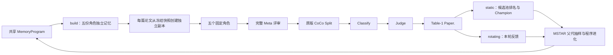

已按当前要求完成代码修复与真实验收，并启动独立 pilot。检查时间：2026-09-17T01:27:49.885270+08:00。当前结论是执行链路已通过；pilot 仍在运行，尚无完整实验结论。

五个 reviewer 共享一个可进化的 MemoryProgram，保留 QUAL / CLAR / SIGN / ORIG / POL 固定职责。每个候选分别构建五份角色记忆；每篇论文从对应冻结快照创建独立运行状态，读操作的可写状态不回传到快照或下一篇论文。实际向量检索使用 Qwen3-Embedding-8B，验收种子和子代均核对了五角色的 4096 维真实向量及检索记录。



共享记忆链路只有 Meta 最终完整评审进入 CoCo，角色单独评分已取消；Native 对照提交其自身最终完整评审。选优使用原版 Table-1 `Paper.`，不使用 Judge JSON 中的六维 `average`。MSTAR 的 softmax 父代选择、轮换反馈、程序反思、有限修复、完整评价入池与 Champion 冻结规则保留。向量检索后端固定为 Qwen3-Embedding-8B；原有 MSTAR 种子/候选仍决定具体记忆读写方式，无记忆和 Native 条件是独立对照。

主要改动及验证：

| 问题 | 已实施处理 | 证据 |
| --- | --- | --- |
| 角色 CoCo 评分带来额外评分路径 | 共享运行器只提交最终 Meta，验证拒绝角色评分凭据 | `shared_experiment.py`、最终目标边界回归 |
| 非空输出可能已经截断 | 实际 tokenizer 预检完整输入与预留输出；只接受非空、单 choice、`finish_reason=stop`；失败原始响应保留 | `llm.py`、`experiment_requests.py`、completion integrity 回归 |
| CoCo 降级结果可能看似成功 | Split 完整覆盖；Classify 每观点均有原版有效响应；Judge 所需类别和整篇字段齐全；统一经 `validate_assessment_receipt()` | `coco_integrity.py`、三阶段 integrity 凭据 |
| 子代吞掉不存在的工具调用 | 已真实复现 `toolkit.llm()` 被广泛异常捕获隐藏；静态检查未知 API，宿主使失败沙箱会话失效，禁止发布后续快照 | `hidden-tool-red.log`、`hidden-tool-tests.log`、`repair-003.json` |
| 我们的早期 Classify 检查比原版过严 | 对照原版代码修正有效无标签响应归一化为 N/A 的语义；仅拒绝没有有效响应的回填 | `original-na-contract-red.log`、`repair-002.json` |

原始错误子代 r0 未入池，没有补零，也没有人工修改其源码以伪装成功。r1 由真实 MSTAR 修复请求产生，其源码与模型响应逐字匹配；见 [真实模型来源](child-model-provenance.json)。公共框架修复后受影响静态对象全部在 epoch 3 重新评价，旧 epoch 不参与当前排名。历史失败及修复记录保留。

已暴露开发论文 `-EHqoysUYLx` 的真实结果如下。所有行均复核了输入/输出绑定、三阶段完整性、必需分数及评价凭据，没有未处理失败。

| 条件 / 阶段 | Paper. | Split 观点 | 已分类观点 | 完整 Judge 任务 | 凭据复核 |
| --- | ---: | ---: | ---: | --- | --- |
| 共享向量种子 | 2.6 | 31 | 31 | 9 + 整篇 | 通过 |
| 真实子代 r1 / Champion | 3.2 | 39 | 39 | 9 + 整篇 | 通过 |
| Native 对照 | 3.0 | 17 | 17 | 8 + 整篇 | 通过 |
| 冻结 Champion 开发终评 | 3.2 | 39 | 39 | 9 + 整篇 | 通过 |

真实子代 `candidate-0001` r1 已与种子共同入池，并成为 Champion。冻结文件为 [winner.json](acceptance/run/winner.json)。开发终评复用了冻结的五份 build 快照，重新完成五角色、Meta 和全部 CoCo 阶段；最终评审文本 SHA256 与冻结前一致，得分再次为 3.2。独立脚本还核对了子代与父代源码不同、固定 `plan_review` AST 相同、排名与冻结哈希正确。详见 [独立验收清单](acceptance-inspection.json)。

预算采用完整论文输入，不做字符截断：AgentReview 输入上限 49,152 tokens，角色输出 8,192、Meta 输出 16,384、Memory 输出 4,096；调用前同时检查服务上下文总容量。CoCo 使用冻结的原版请求配置，并逐请求检查各自服务容量。真实子代的 10 次 build 调用及 11 次查询/审稿/Meta 调用均完整且未超预算，CoCo 另有 3 次 Split、39 次分类及 10 次 Judge 完整任务凭据。模型截断不会进入汇总或评分；失败不赋零、不入池。

当前回归结果为 **138 passed，41 subtests passed**，见 [测试记录](current-tests.log)。`git diff --check` 和执行入口编译检查通过。CoCo 仓库 `git status --porcelain` 为空；原版源码及指标公式未改。本次服务配置为本地 Qwen3.8-27B 负责 Reviewer/Meta/MSTAR/Judge，专用 Qwen3-8B 模型负责 Split 和 Classify；这不等同于宣称复现 CoCo 论文的全部模型设定。

Pilot 已于 2026-09-17 01:25（Asia/Shanghai）启动，PID **2520421**。实际冻结协议：[protocol.fail-fast.json](pilot/protocol.fail-fast.json)。build 4 篇、static 3 篇、rotating 4 篇；3 次 MSTAR 进化尝试，每次抽 2 篇旋转反馈；包含三种共享记忆种子、各自匹配的无记忆对照及 Native 对照，共 7 个初始条件。完整评价失败会暂停；候选在有限修复后仍失败即停止该 pilot，不跳过、不补零。启动检查时已有 5 次真实请求完整结束，控制器 running、无请求失败，见 [启动检查](pilot-startup-check.json)。这只是启动状态，不代表 pilot 已完成。

已确认的限制需要在后续正式实验中处理：

- CoCo 对分类和格式敏感。同一份 Native 最终评审文本在两轮完整评分中为 3.6 和 3.0；下游整篇 Judge 输入相差一个 Strengths 标题，详见 [评分敏感性记录](native-score-sensitivity.json)。不能据单次差值认定进化带来稳定提升。
- 当前只有单篇功能验收，pilot 的 static 也仅 3 篇；3 次进化尝试不是 3 次独立重复实验。正式结论需要更大的固定队列、独立重复与不确定性报告。
- Reviewer 与 Judge 使用同一基础模型；本次验收不能排除裁判偏好。正式效果还需独立评价或人工盲评，不能只由用于优化的 Paper. 自证。
- 历史暴露清单与按标题构建的论文家族审计仍不完整，不能支持正式未见测试主张。准备阶段仅冻结预留 sealed 资产与身份，本运行器没有将 sealed 论文用于生成、检索或评分。开发终评使用同一篇已暴露论文。

后续状态以 [search.json](pilot/run/search.json)、[failure-policy.json](pilot/run/failure-policy.json)、完整评价凭据和 [pilot.log](pilot.log) 为准，不能只看 PID 或退出码。复核本次验收可运行：

```bash
cd /data/xyj/shengao/AgentReview_0915
PYTHONPATH=AgentReview /data/xyj/envs/coco-original/bin/python deployment/inspect_shared_acceptance.py
```
