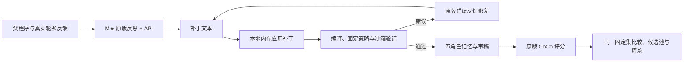

# 0930：停止实验并恢复 M★ 补丁式自进化

当前架构与运行入口见 [ARCHITECTURE_0930.md](ARCHITECTURE_0930.md) 和 [仓库 README](../README.md)。本文保留 2026-09-29 的阶段记录。

2026-09-29：按用户要求停止现有实验、CoCo 模型、远端守护和 SSH 转发。本次完成适配和独立验收，**没有重新启动实验或 CoCo，没有新增进化效果分数**。

## 已停止的服务

本地 18 的三个 pilot 服务、Classify 和 Split 转发，以及 139 的 Split 和模型守护均为 `inactive`、`MainPID=0`。本地 13098/13099 已关闭。核对时本地 GPU 6、7 各空闲 22434 MiB，139 的 GPU 5 空闲 48494 MiB；保留其他任务的显存占用。[停机记录](../metadata/mstar-realignment/shutdown.json)

旧实验状态、三次失败、已有评分和协议均保留，不重写失败为成功，不清空预算后伪装成原实验继续运行。

## 原因与适配边界

原反思适配要求模型返回 `{change, program}` JSON，直接取出完整 Python 源码；这不是本地 M★ 默认的补丁协议。提示也没有准确给出候选沙箱接口，导致模型生成不存在的 `toolkit.memory_runtime`。本次删除该 JSON 源码返回协议，明确绑定实际接口，不为模型臆造的调用增加伪接口。

自进化实现以 `/data/xyj/shengao/mstar` 的 `09a8d34f69588a85fde78b20702d14f056267956` 为依据。`reflector.py`、`patcher.py`、`prompts.py`、`types.py` 和 LICENSE 原样复制到 `research_v2/vendor/mstar/`，保存逐文件哈希。适配器加载原版函数体，仅替换 provider、日志和宿主验证绑定，不安装不需要的 litellm/weave 运行栈。

CoCo 在这套系统中负责评分；M★ 负责反思和程序变异。官方 CoCo checkout `2580687ee5d4ad2ac4b9730afb8f1dfda22e40db`、原 M★ 仓库均保持干净。本次也没有更改现有 CoCo 包装层、提示、切分、分类或指标逻辑。[源码与历史文件校验](../metadata/mstar-realignment/source-verification.json)

| 环节 | 适配后的行为 |
|---|---|
| 反思输入 | 父程序、轮换集真实 CoCo 回执、选定案例的完整审稿轨迹、历史谱系；不读取测试反馈 |
| 模型输出 | 原版 `*** Commit Message` 与 `*** Begin Patch` / `*** Update File: program.py` 文本，不请求 JSON response format |
| 应用补丁 | 调用原版 patcher，在内存中的虚拟 `program.py` 上应用，不允许模型直接操作宿主文件 |
| 原版兜底 | 保留原版 fenced Python 完整程序兜底，不新增 JSON 兼容分支 |
| 验证与修复 | 真实 AgentReview 静态检查、固定审稿策略检查、bubblewrap 写入/检索冒烟；错误交给原版最多三次修复循环 |
| 实际运行错误 | 接入原版 `fix_runtime_violation`；原版编译修复耗尽后不在外层重复开启同一修复循环 |
| 可变范围 | KnowledgeItem/Query、KnowledgeBase 读写、四条记忆指令；保持五角色身份、各自记忆库、固定 `plan_review` |
| API 与容量 | 方舟 DeepSeek，高思考；使用现有模型容量预算，不恢复原版 3000 字符上限或任意短输出上限 |
| 后续评分 | 新程序构建五份记忆、生成五角色及最终评审，再调用原版 CoCo；本次未执行此阶段 |



流程中保留的 JSON 数据文件是回执、请求账本和程序来源记录。KnowledgeItem/Query 的结构化输入也是原有运行接口；它们与已经删除的“反思必须返回 JSON 源码”不是同一环节。

## 真实验收暴露并修复的漏检

第一份 API 输出在一个补丁内两次声明 `*** Update File: program.py`。原版 `codex-apply-patch==0.4.0` 只保留了后一组修改，导致 `write()` 使用了没有加入 dataclass 的字段。旧冒烟测试采用空角色和空查询默认值，跳过实际路径，错误地判定通过。

- 适配层现在明确要求同一文件的一组连续 hunks；发现重复声明时交给原版格式修复循环，避免静默丢失修改。原版文件未修改。
- 冒烟输入现在填入实际角色、非空经验和查询，真正执行写入和检索。不向候选提供虚构字段或宽松兼容接口。
- 修复正常列表 `lines = lines[1:]` 被误判为文本截断的问题；文本截断检查仍按实际类型证据判断。
- 原始验收产物完整保留，但其自动“通过”已被[复核记录](../metadata/mstar-realignment/initial-acceptance-review.json)否决，不能用作成功证据。

新的独立验收使用旧实验父程序和真实轮换反馈，一次 DeepSeek 请求，**91.182 秒**完成原版补丁应用、非空样本写入/检索、固定策略和沙箱验证。[有效验收记录](../metadata/mstar-realignment/live-acceptance-v2.json)

此次模型实际修改了记忆交互指令、新增 subcategories/focus 字段、经验标签提取、按角色和主题组织检索。它们已经出现在本地实际源码 diff 中，不只是模型的修改声明。生成策略仍是未经 CoCo 评价的候选；不能推断其一定提高评分。

- [模型原始补丁](../artifacts/mstar-adaptation-0930-v2/reflection/responses/000.txt)
- [实际 Python 差异](../artifacts/mstar-adaptation-0930-v2/reflection/program.diff)
- [完整候选程序](../artifacts/mstar-adaptation-0930-v2/reflection/program.py)
- [原版修复与验证轨迹](../artifacts/mstar-adaptation-0930-v2/reflection/mstar-trace.json)

## 后续配置与记录位置

当前准备好的配置是 [0930-pilot-mstar-native-v2](../config/0930-pilot-mstar-native-v2/protocol.frozen.json)。它绑定最终适配代码；之前的 `mstar-native` 配置仅用于保留第一份验收的身份，不能作为当前运行配置。

仍为 15 篇：build 4、static 3、rotating 5、sealed_test 3，最多五次进化尝试。取消连续三次候选失败就提前暂停的附加条件，失败候选仍记录并消耗尝试次数；公共运行故障仍显式报告，不吞掉失败。CoCo 评分配置、五角色、数据划分和 embedding 模型不变。

运行后的每次反思记录在 `search/proposals/aN-eE/`，运行错误修复记录在 `search/repairs/eE/<candidate>/rN/`：

- `responses/*.txt`：每次模型原始文本，包括错误后的修复输出。
- `validation/*.py`、`mstar-trace.json`：每次实际应用的程序、错误、修复次数和上游源文件身份。
- `program.py`、`program.source.json`：通过验证的程序与来源绑定。
- 现有逐轮报告保存实际 diff、同固定集 CoCo 分数和逐篇差值；失败阶段没有分数，查看上述轨迹而非把父程序占位记录当作成功修改。

本次全部记录与修复前归档位于 `metadata/mstar-realignment/`。原始候选声明、实际修改、执行成功、CoCo 分数四者分别保存；未执行的评分不填零。

原版补丁依赖采用独立目录 `/data/xyj/envs/agentreview-mstar-patch/`，版本与 M★ 的 `uv.lock` 一致。部署到其他环境时安装相应 Python ABI 的依赖并重新冻结路径/哈希，不直接复制当前 CPython 3.12 二进制：

```bash
/data/xyj/envs/coco-original/bin/python -m pip install --no-deps --only-binary=:all: \
  --target /data/xyj/envs/agentreview-mstar-patch 'codex-apply-patch==0.4.0'
```

测试命令（`PYTHONPATH` 也供子进程测试使用）：

```bash
PYTHONPATH=AgentReview /data/xyj/envs/coco-original/bin/python -m pytest -q AgentReview/tests
```

最终回归为 **309 passed、101 subtests passed，92.81 秒**。见 [回归日志](../metadata/mstar-realignment/regression-v2-verified.log)、[验收汇总](../metadata/mstar-realignment/validation.json)及[相对本次修复前的代码差异](../metadata/mstar-realignment/adapter.diff)。这些验收不包含新的 CoCo 实验成绩。
