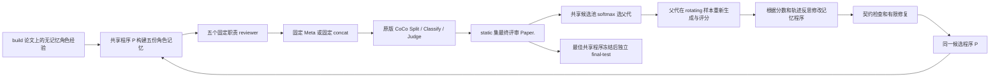

# 共享 Memory MSTAR × 原版 CoCo：架构检查与重跑方案

## Material Passport

- 类型：代码审计、工程验收与实验方案；不是实验效果报告。
- 检查时间：2026-09-16，Asia/Shanghai。
- AgentReview 起点：`d65b6a1`；CoCo：`f9b16fadf08678ce88fadcd73252abcd2d1f88f7`。
- 用户确认的目标：进化共享记忆策略，固定 QUAL / CLAR / SIGN / ORIG / POL 五角色职责。
- 证据：当前代码、真实 Sandbox、pytest、真实服务启动和接口检查、真实 embedding、真实 Native 生成至 CoCo 完整评分；成功凭据已独立复核。
- 尚未产生正式共享搜索效果结果。配置模板和已有评分配置不能代替正式实验协议。

## 结论与实际闭环

`shared-experiment` 的核心结构符合目标。一个候选是一份共享 MemoryProgram，而不是五个角色各选一个程序。共享的是处理记忆的规则；五个角色的记忆内容、快照和读写状态独立。



核心证据：

| 要求 | 实现位置与实际行为 |
|---|---|
| 五角色共用策略 | `shared_experiment.py:238` / `:259`，传入同一个候选 program，分别绑定五份角色 snapshot |
| 只进化记忆 | `_candidate_check()` 保持非记忆 policy AST；`propose()` 只允许 Schema、read/write 和记忆指令变更 |
| CoCo 决定 fitness | `assess()` 返回最终评审 receipt 的 `mean_score`；`development_coco.py` 绑定 Table-1 `Paper.` |
| 按 MSTAR 搜索 | `shared_evolution.py:26` softmax；`run()` 重新评价父代 rotating 样本、生成子代、static 评价、有效子代入池 |
| 允许探索低分子代 | 有效且完成评价的子代都会入池；不要求胜过父代，Champion 只在更高分时更新 |
| 初始种群 | Vector Search、LLM Summarizer、Experience Learner 三种记忆程序 |
| 故障不伪装低分 | 失败记录空分数并暂停或计入候选失败；公共修复通过新 epoch 统一重评 |

这里的 fitness 是“最终完整评审的 Paper.”，不是五个角色分数的平均，也不是旧的 internal 1–5 evaluator。旧 `formal-evolution` / `run-evolution` 不应作为本轮入口。

MSTAR 方法依据：[论文方法与算法](https://arxiv.org/html/2604.11811v2)。当前应用保留种群、softmax、static / rotating、代码反思与有限修复的核心机制；它是审稿任务适配，不等于原论文全部实验细节的逐项复现。例如这里 rotating 使用固定随机种子的随机抽样，没有复现论文附录的代表性聚类选样。

## 已发现的问题

### P1：正式数据协议尚未准备好

当前只有 pending 模板，没有本轮四分区资产、完整历史暴露库存与可核验的 family audit。实际加载模板返回 `ExperimentProtocolError: experiment requires shared-memory-experiment-v1 and status=frozen`，证据：`artifacts/audit-20260916/formal-preflight.json`。

历史已经查看过的 1300 / 902 / 805 等集合不能直接重新命名为新封存测试。family audit 的格式检查只能验证“提供的身份和哈希”，不能自动证明填入的版本家族关系和历史库存完整。需要从保留的历史产物建立库存，再冻结四分区。普通开发验收不声称具有最终测试效力。

### P1：候选预检与实际调用预算不一致，已修正

原 `validate_program()` 对 write/read 均硬编码只允许一次 LLM 调用。共享协议允许 `memory_build_llm_calls` / `memory_read_llm_calls` 大于 1，合法的两次调用程序会在预检被拒绝。

实际复现：同一程序在真实 Sandbox、额度 2 下返回 `bounded summary`，旧预检报告 `LLM call limit exceeded for protocol_smoke_read: 1`。保存于 `artifacts/audit-20260916/budget-mismatch-reproduction.json`。

修正：共享 backend 将冻结的 memory runtime 与 seed kind 传入 validator；validator 分别使用实际 read/write 额度。Experience Learner / evolved 的 build 总额度先扣除一次宿主 KnowledgeItem 提炼调用，剩余才是 `write()` 额度；反思提示也说明了这一点。旧入口未传入时仍使用原默认值 1。新增真实 Sandbox 测试覆盖两种 seed kind 的 read/write：允许两次时通过、剩余仅一次时失败。未修改 softmax、fitness 或入池规则。

### P1：截断输出可能被当作成功，已复现，尚未修正

`llm.py:167` 只读取非空 `message.content`，未检查 `finish_reason`。用实际客户端方法配合返回 `finish_reason="length"` 的测试传输，未完成句子仍被正常返回。证据：`artifacts/audit-20260916/truncation-reproduction.json`。

影响：自由文本 specialist review 可以不完整，却进入成功产物和评分；JSON 类输出有机会被后续解析拦住，但不能保护所有评审。正式运行前应保存 finish_reason / usage / 原始响应，对 length 截断显式失败或按预注册预算处理。不要静默放大输出额度后混用同一实验身份。原版 CoCo 的请求、解析和评分规则应保持来源语义。

### P1：真实部署的两个阻塞，已修正并上线

1. 虚拟环境 Python 不会自动激活其 `bin`。FlashInfer 找不到环境中已安装的 `ninja`，三服务首次启动均失败。启动器现将 serving Python 所在目录加入子进程 PATH。
2. Split/Classify 没有显式限制服务端 `max-num-seqs`，在当前 vLLM 和 4090 上初始化触发 CUDA OOM。现三个服务均显式配置 8；Split/Classify 显存使用率设为 0.80，Judge 为 0.85。

最终部署配置：`artifacts/deployment/original-coco/services.bounded-20260916.json`。Judge 使用 GPU 0–3、端口 18001；Split 使用 GPU 4–5、端口 13099；Classify 使用 GPU 6–7、端口 13098。日志与 PID 身份在 `services-bounded/`。三服务均已通过实际进程身份和模型路径检查。

客户端 CoCo 并发仍为原版 64 / 128 / 128；TP=4/2/2、服务端排队容量 8、应用角色串行循环是三个不同概念。未停止其他用户进程。

### P2：强制角色诊断放大成本与故障范围

`assess()` 先评分最终评审，再串行评分五份 specialist review，`validate()` 强制要求五份诊断 receipt 完整。任一角色诊断故障都会使整轮暂停，即使最终 Paper. 已成功。现有测试明确覆盖此行为。

它不改变主 fitness，但每个非 Native 系统有六份被评分的评审。若需要提速，可在新协议里明确把角色诊断移至种子 / Champion 或独立报告阶段；这是协议调整，本次没有擅自改变。

### P1：生成请求继承代理导致 localhost 502，已修正

首次真实 Native 验收在 chat completion 返回502，Judge没有收到对应请求；tokenize/readiness 使用无代理连接，因此就绪检查没有捕获此问题。首次失败原样保存在 `native-scoring/native/raw.json`，没有覆盖。

`OpenAICompletionClient` 现对 localhost / 回环IP使用 `DefaultHttpxClient(trust_env=False)`，保留SDK默认超时和连接参数。非回环地址仍沿用原有环境行为。新增真实HTTP回环测试，设置不可用代理、移除NO_PROXY，先观察连接失败，再验证修正后只收到一次请求。第二次验收使用独立目录 `native-scoring-direct/`。

### P2：旧入口的历史测试失败，基线已确认

扩展检查旧 bootstrap / formal-transition 时，pytest报告 `16 failed, 48 passed, 32 subtests passed`（失败计数包含子测试）。失败集中于旧 `FORMAL_JUDGE_MODEL_ROOT=/data0/xyj/models/Qwen3.8-27B` 与一项 bootstrap 生成配置变化检查。没有将它们写成全仓通过。

将未修改的 `d65b6a1` 导出到独立临时目录，两个代表性测试重现相同错误，证据在 `baseline-tests.xml` / `baseline-tests.log`。因此这两类故障在本次改动前已存在。当前共享主入口的验证结果与这些旧入口分别报告；本次未展开修复历史流程。

### P2：每份评价重复哈希全部模型权重

`development_coco._validate_config()` 每次调用 `_model_identity()` 完整遍历并哈希模型文件。当前每次读取约 **84.64 GiB**：BERT 1.33、Classify 16.27、Judge 51.77、Split 15.27 GiB。一个候选的最终评审加五角色诊断，仅这项即约 **507.84 GiB** 的逻辑读取和 SHA-256 计算。

这不是 GPU 算力问题，也不能用 GPU 利用率判断评价是否卡死。应考虑启动时完整核验，随后使用有清晰失效规则的进程内身份缓存或已验证只读模型部署；不可简单删除身份校验。本次保持验证行为不变。

### P2：反思上下文及可复现身份仍需加固

- `propose()` 将 rotating 论文的最终 review、五份完整角色产物和不断增长的历史整体 JSON 序列化。预算超限会由 PersistentCompletionClient 拒绝，搜索全局暂停。上线前应记录实际 token 数并做长轨迹探针；不能只保证单篇论文输入能放进窗口。
- `generation_identity()` 绑定许多生成文件，但未绑定 `llm.py`、模型配置常量和 `memory_evolution/embedding_adapter.py`。代码变更后的冻结身份完整性值得补全。
- pending 模板中的 vLLM / Transformers 版本是历史值。新提案已按本机 0.27.1 / 5.15.1 填写，不能直接沿用旧值声称完全复现。

### 解释结果时需要控制的因素

- 三种 memory seed 是三种初始化方法，不是三次独立随机重复。
- 用同一个基础模型生成评审和担任 Judge，会有相关误差风险。主实验保留冻结 CoCo Judge；如增加外部人工/异模型检查，单独报告，不参与挑选 Champion。
- 五角色诊断不能替代最终评审 fitness；Meta 的压缩/整合作用应通过预注册 concat 消融分析。
- static 被反复用于选优，不能作为无偏最终效果。不得按 static 最好结果修改测试集或追加搜索后反复查看同一个 sealed test。

## 分阶段重跑设计

新参数草案：`AgentReview/configs/shared_memory_experiment.pilot-20260916.pending.json`。明确保持 pending，待数据与上述正式门槛满足后才能冻结。

| 阶段 | 数据与预算 | 通过标准 |
|---|---|---|
| 服务/评分验收 | 一篇已暴露开发论文，真实 Native → 原版 CoCo | 完整 assessment，真实 Paper.，输入/模型/原始阶段产物可追溯 |
| 共享闭环验收 | 建议 build=2、static=2、rotating=2，每轮取1，attempts=1 | 五角色同 program hash、五份独立非空 memory，父代反馈、至少一个实际子代完整 CoCo receipt 和谱系；若子代失败则不能宣称进化通过 |
| 开发 pilot | 建议 build=26、static=13、rotating=26，每轮取2，attempts=3 | 完整对照与候选比较，测实际耗时/故障率/上下文大小；这不是效果显著性检验 |
| 正式搜索 | 起始建议 build=130、static=65、rotating=130，每轮取4，attempts=20；3个 search random seeds | 相同开发身份与固定条件，独立输出目录，完整评分与失败预算 |
| 一次性最终评价 | 起始建议 sealed=260，按 venue-year 分层并按 family 隔离 | 先冻结全部系统，再运行预注册测试；最终数量取决于可用未暴露 family，不能为凑数声称已封存 |

以上样本量是资源可审阅的起始方案，不是功效分析结论。正式最终样本量应根据开发 pilot 的逐论文配对差值方差和有意义的最小效应确定，并在测试开放前固定。

配对比较：Native 单列；三个匹配 no-memory 对照；三个固定 memory seed；MSTAR Champion。核心比较是 Champion 相对最佳固定 memory seed 和 no-memory 的增益。最终保存逐篇配对差值、均值及论文/研究家族层面的 bootstrap 95% CI，并分 venue-year 报告；预指定主比较，多个探索比较明确标注。CoCo 多质量维度保留原版 `X` 和真实有效分母。

pilot 建议固定：Meta、S2 off、生成 temperature=0、生成 thinking=false、完整论文、Memory Query instruction 模式、build/read 各最多2次、同一个本地 Qwen3.8-27B。Judge 沿用原版 thinking/请求预算，不与 reviewer 设置混淆。S2 off 用于隔离 Memory 效果；另设 S2 消融需要新配置。

按当前强制角色诊断实现，忽略失败/修复时，开发阶段被评分的 review 数为 `(37 + 6E) × S + 6E × r`，其中 E=attempts、S=static 篇数、r=每轮 rotating 篇数。pilot E=3、S=13、r=2 时为 **751 份 review 的完整 CoCo 流程**，每份还包含多个类别 Judge 请求，不能当作751次模型调用。先依据真实验收测时，再承诺总耗时。

## 验证记录与启动顺序

- 最终共享组合（包含额度、宿主提炼扣额、部署、回环代理修正）：**143 tests + 35 subtests passed**，35.78秒；`artifacts/audit-20260916/final-shared-tests.xml`。历史扩展测试失败与基线对比见上文。
- Qwen3-Embedding-8B：CPU、float32、SDPA，实际生成4096维向量，L2 norm≈1；`embedding-smoke.json`。CPU 可供工程验收，正式吞吐需要实测。
- CoCo：93个已跟踪 `src` 文件逐字节与 HEAD 一致；没有修改评分公式、提示或解析。
- 服务：三服务真实 ready；API ready 不等于生成/评分验收通过。
- Native → CoCo：第一次因代理失败；修正后的验收已完成，退出码0。记录在 `artifacts/audit-20260916/native-scoring-direct.log`，成功凭据为 `native-scoring-direct/acceptance.json`。
- 真实Native评审：论文 `-EHqoysUYLx`，评审6797字符；Split、Classify、Judge全部完成，最终 **CoCo Table-1 Paper.=3.2/5**，完整assessment已通过独立 `validate_assessment_receipt()` 复核。此单篇已暴露开发样本只证明生成/评分链路可用，不是正式效果结果，也不证明共享Memory/MSTAR闭环已通过。
- 实际Split得到44个观点。Classify原版日志 `Retry count: 47` 包含首轮44次处理与额外3次处理，不能解读为47次失败；分类阶段累计prompt=134344、completion=25346、total=159690 tokens。这是单篇开发能力验收的实际成本，不能直接推断全部论文均相同。
- 共享 MSTAR 真实闭环、正式搜索、最终测试：尚未完成。

```bash
# 当前实际部署配置，状态检查不会重启服务
/data/xyj/envs/coco-original/bin/python deployment/coco_services.py status \
  --config artifacts/deployment/original-coco/services.bounded-20260916.json --role judge
/data/xyj/envs/coco-original/bin/python deployment/validate_original_coco.py check

# 本次已发起的独立验收；先检查既有进程/产物，避免并发重复提交
/data/xyj/envs/coco-original/bin/python deployment/validate_original_coco.py run \
  --output artifacts/audit-20260916/native-scoring-direct

# 后续数据和协议真正冻结后执行，不能把 pending 文件改名冒充 frozen
PYTHONPATH=AgentReview /data/xyj/envs/coco-original/bin/python -m agentreview.research_v2 \
  shared-experiment --action preflight --protocol /absolute/experiment.frozen.json --output /absolute/new-run
PYTHONPATH=AgentReview /data/xyj/envs/coco-original/bin/python -m agentreview.research_v2 \
  shared-experiment --action run --protocol /absolute/experiment.frozen.json --output /absolute/new-run
```

恢复必须保留请求/阶段预算和历史产物；公共故障按已有 repair evidence + 新 epoch 机制处理。单独报告命令只读取已保存结果，不能把请求量、进程存活或 GPU 占用当作实验完成。
