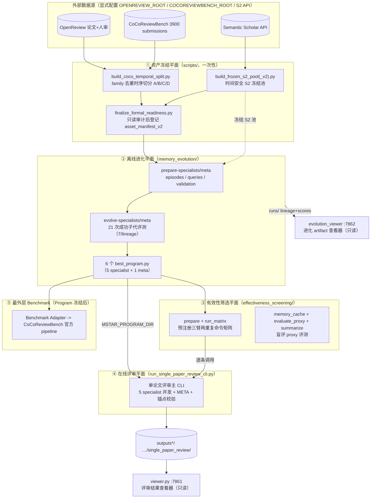
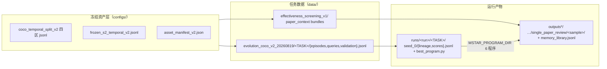

# AgentReview M★ 代码架构全景解析（2026-08-20 版）

> **基准**：commit `7256ffc`（20260820_修复云端使用路径不同步等问题）。
> 本文以代码为准重写，取代本文件 0811–0812 期间的旧版本。旧版中「20 iterations / 5 evolution seeds / screening v1 / OpenReview 三分数据 / environments 层在用」等表述均已过时，请勿引用。
> 术语定义见 [CONTEXT.md](CONTEXT.md)；系统边界见 [docs/adr/0005](docs/adr/0005-frozen-identity-evolvable-harness-outermost-benchmark.md)；数据协议见 [docs/adr/0006](docs/adr/0006-data-protocol-four-zones.md)；进化语义见 [docs/adr/0007](docs/adr/0007-evolution-semantics-fresh-state-lineage-budget.md)。全部文档的分类与新旧判定见 [docs/DOCUMENT_INDEX.md](docs/DOCUMENT_INDEX.md)。

---

## 0. 一页总览

系统分五个平面，外加两个只读查看器：



关键事实（旧文档常错处）：

1. **真正的实验入口是顶层 `run_single_paper_review_cli.py`（2135 行）**，它完全绕过 Arena/Environment 循环，自己做并发、断点续跑与锚点校验。`agentreview/arena.py + paper_review_arena.py + environments/ + ui/cli.py` 是旧多论文模式遗产，**当前主流程不经过**（见 §6 活/死代码）。
2. 正式进化预算是 **21 次 successful child evaluations（每 lineage 7 个）+ 单个 outer seed 0**，不是旧的「20 迭代 × 5 seeds」。
3. 数据面是 **四区 family-level temporal split v2**（A/B/C/D = 2391/299/300/899，3889 个 family targets），不是旧的 OpenReview train/validation/test 三分。
4. 三条 Seed lineage：`vector_search` / `llm_summarizer` / `experience_learner`（`memory_evolution/seeds/`）；`seed_experience` 是禁用的旧臂名。
5. 默认模型是 **kimi-k3**（TASK/REFLECTOR/JUDGE 三处默认），README 中的 gpt-5-mini 示例已滞后。

---

## 1. 目录地图

```
AgentReview_0811/
├── CONTEXT.md                          # 术语权威（统一语言表）
├── AgentReview M★ 代码架构全景解析.md    # 本文
├── docs/
│   ├── DOCUMENT_INDEX.md               # 全部文档的分类与新旧判定
│   ├── DEPRECATED.md                   # 已废弃代码注册表（活文档）
│   ├── RUN_AUDIT_20260818.md           # 在线管线运行前审计（B1/B2 等）
│   ├── TODO.md                         # 工程待办
│   └── adr/0001–0007                   # 架构决策记录
└── AgentReview/                        # 代码根（约 2 万行 Python）
    ├── run_single_paper_review_cli.py  # ★ 在线评审主 CLI（主实验入口）
    ├── run.sh / pilot_full.sh / QUAL_test.sh / end2end_smoke.sh
    ├── agentreview/                    # 评审框架包（核心+遗产并存）
    ├── memory_evolution/               # M★ 离线进化引擎（约 9900 行）
    ├── effectiveness_screening/        # 三臂两重复有效性筛选（约 2560 行）
    ├── evolution_viewer/               # 进化查看器（Gradio :7862，只读）
    ├── viewer.py                       # 评审结果查看器（Gradio :7861，只读）
    ├── scripts/                        # 一次性资产构建脚本
    ├── configs/                        # 冻结资产：split v2 / S2 池 v2 / asset manifests
    ├── tests/                          # 21 个 unittest 文件
    ├── data/                           # 进化任务数据（prepare 产物）
    ├── runs/                           # 进化运行产物（lineage/scores/traces）
    ├── outputs*/                       # 评审实验产物
    └── papers_eval20/ test_data/       # 评审输入论文
```

---

## 2. ① 资产冻结平面（`scripts/`，一次性）

| 脚本 | 行数 | 职责 | 产物 |
|---|---|---|---|
| `scripts/build_coco_temporal_split.py` | 774 | CoCo 3900 条 submission → 规范化 title/paperhash → family 去重 → 按 deterministic 规则选 representative → 时序切分 | `configs/coco_temporal_split_v2/{historical_experience, evolution_validation, effectiveness_holdout, held_out_benchmark_test}.jsonl + manifest.json + paper_families.jsonl` |
| `scripts/build_frozen_s2_pool.py` | 302 | v1 冻结 S2 检索池（断点续传、时间安全：publication date 晚于 cutoff 的结果拒绝） | `configs/frozen_s2_temporal_v1.jsonl` |
| `scripts/build_frozen_s2_pool_v2.py` | 622 | 查询绑定（query-bound）的 v2 池；v1 clean 记录按 canonical title 迁移，其余重检索 | `configs/frozen_s2_temporal_v2.jsonl`（+.manifest.json +.work/） |
| `scripts/finalize_formal_readiness.py` | 318 | 只读协议审计通过后，原子更新 Asset Manifest v2 并登记正式资产；**绝不构建数据或运行实验** | `configs/asset_manifest_v2.json` |

四区身份由冻结 manifest 决定，不靠目录名。`memory_evolution/assets.py:FOUR_ZONES` 是代码侧权威定义；`audit_four_zone_isolation` 强制两两 paper ID / normalized title / family 零重叠，且 `max(A/B/C cutoff) ≤ min(D cutoff)`。

**注意**：canonical 数据（`data/evolution_coco_v2_20260819` 五任务 bundle，已核 SHA）已经冻结——**不要再运行 prepare-specialists 重建**（见 [CLOUD_FORMAL_ALIGNMENT_20260820.md](../CLOUD_FORMAL_ALIGNMENT_20260820.md)）。

---

## 3. ② 离线进化平面（`memory_evolution/`）

统一入口：`python -m memory_evolution.cli`，子命令 `prepare-specialists / prepare-test / prepare-meta / cache-meta-inputs / evolve-task / evolve-specialists / evolve-meta / evaluate / final-evaluate-suite`。全流程由 `pilot_full.sh` 编排（prepare-specialists → evolve-specialists → cache-meta-inputs → prepare-meta → evolve-meta → pilot_report）。

### 3.1 进化循环（`search.py`，1324 行）

```
parent 选择（softmax）
  → reflector.mutate_program（LLM 突变，contextual V4A patch + compile_fix_loop）
  → quality 质量门（静态检查：import 白名单 / KnowledgeBase 协议 / 读上限；编译+冒烟）
  → sandbox 内评测（A 区回放积累 memory → B 区冻结评审 → fitness）
  → lineage.jsonl / scores.jsonl 持久化（断点续跑）
```

- 正式预算：`resolve_formal_attempt_budget` = **21 次成功子代评测，每 lineage 7 个**；单个 outer seed 0。
- 每次 fitness evaluation 语义：`fresh empty state → 按冻结顺序回放 A 区 → 自产 Experience/Memory → B 区 Evolution Validation`；B 的 gold 只进 `evaluator_only/` 产物。
- 验证集：static 25 + rotating 5（`subset_selection.py`，冻结 BGE-M3，正式模式无随机回退）。

### 3.2 模块清单

| 模块 | 行数 | 职责 |
|---|---|---|
| `cli.py` | 1356 | 统一 CLI；默认模型 kimi-k3；正式协议数字固化于此 |
| `search.py` | 1324 | 进化主循环 + 持久化/断点续跑 |
| `agentreview_data.py` | 1422 | OpenReview→进化任务数据；episode 构建；**泄漏审计** `assert_no_human_reference_leak` |
| `toolkit.py` | 594 | `MemoryToolkit`：冻结 S2 池加载/校验、内存向量集合、LLM 调用——进化程序唯一可用 API 面 |
| `formal_protocol.py` | 574 | 正式实验协议门：冻结 CoCo 溯源（路径重映射+SHA）、v2 sidecar、family 目标校验 |
| `sandbox.py` / `sandbox_worker.py` | 410/473 | bubblewrap + rlimit 隔离执行候选程序；**宿主进程永不执行候选代码** |
| `reflector.py` | 429 | LLM 突变 + mutation scope 校验 + 编译修复循环 |
| `quality.py` | 360 | 质量门（静态检查 + 编译冒烟） |
| `evaluator.py` | 381 | 单候选沙箱评测（trace 快照、A/B 冻结评审） |
| `metrics.py` | 328 | 指标注册表；`CoCoReviewFitness`（专家+Meta 适应度） |
| `embedding_adapter.py` | 391 | **BGE-M3 嵌入 + 持久精确文本缓存**（SQLite，默认 `cache/embedding_cache.sqlite3`，schema `embedding-cache-sqlite-v1`；2026-08 新增） |
| `meta_cache.py` | 203 | META 任务分折泄漏安全输入缓存 |
| `tasks.py` | 131 | 6 任务注册（QUAL/CLAR/SIGN/ORIG/POL/META）、`verify_promoted_program` |
| `assets.py` | 435 | 四区隔离、Asset Manifest、temporal manifest 加载 |
| `checkpoint.py` | 214 | 身份绑定检查点（canonical SHA256、memory_library 快照） |
| `subset_selection.py` | 188 | static/rotating 验证集与 episode 子集选择 |
| `task_agent.py` | 186 | judge 等 LLM 角色 |
| `coco_adapter.py` | 206 | `FrozenCoCoAdapter`：固定 commit 加载 CoCo 官方实现 |
| `coco_reference.py` / `benchmark_adapter.py` | 135/67 | CoCo 人审参考（防泄漏哈希）/ Benchmark Adapter 协议 |
| `program_protocol.py` / `models.py` | 37/63 | `KnowledgeItem/Query/KnowledgeBase` 协议；`Episode/EvalItem/EvalResult` |
| `integration.py` | 68 | `MemoryHarnessAdapter`：把 MemoryToolkit 适配给在线评审 CLI |
| `api_preflight.py` / `pilot_report.py` | 107/92 | API 预检（不泄漏 key）/ pilot 摘要 |
| `seeds/` | — | 三个种子程序：`vector_search.py` / `llm_summarizer.py` / `experience_learner.py` |

### 3.3 进化产物布局

```
runs/<run_name>/<TASK>/
├── suite_manifest.json / best_program.py     # 提升产物（= MSTAR_PROGRAM_DIR 来源）
└── seed_0/
    ├── lineage.jsonl / scores.jsonl           # 进化谱系与分数（evolution_viewer 读这个）
    ├── pool/program_*.py                      # 候选池
    ├── traces/ selection.json config.json best_eval_report.json
```

---

## 4. ④ 在线评审平面（`run_single_paper_review_cli.py` + `agentreview/`）

单篇论文评审流水线（当前主实验入口，`run.sh` 为生产样例）：

```
discover_markdown_papers（frozen bundle / manifest+split / 直接 md 路径）
  → MarkdownPaperExtractorPlayer 建规范上下文 + source anchors（可选注入冻结 S2）
  → run_parallel_reviews：ThreadPoolExecutor 并发 5 个 specialist
      · --memory_mode mstar_program 时注入 M★ 程序记忆
        （--memory_program_dir 的 6 个程序 + BGE-M3 嵌入 + 可选预编译缓存）
  → 5 份评审冻结后运行 META（_mstar_meta_memory_context）
  → validate_review_source_anchors / call_role_with_anchor_repair（引用锚点校验修复）
  → save_structured_outputs → commit_global_memory 写回 memory_library.jsonl
```

运行时保障：specialist checkpoint 断点续跑、`--strict_history_resume` 身份绑定检查点（崩溃窗口内下一篇强制 overwrite）、`--reuse_completed_specialists`、`--replicate_id/--run_seed`、批量 `batch_manifest.json`。

`agentreview/` 包内的角色分工：

| 模块 | 状态 | 职责 |
|---|---|---|
| `paper_review_player_md.py` | **活** | Markdown 论文抽取器（单论文模式实际入口角色） |
| `paper_context.py` | **活** | canonical paper context 构建与裁剪（版本常量 `CANONICAL_PAPER_CONTEXT_VERSION`，防 provenance 泄漏）；被 memory_evolution / effectiveness_screening 反向依赖的跨包契约点 |
| `source_map.py` | **活** | source anchors 构建 |
| `single_paper_review_roles.py` | **活** | 5 specialist + META 角色工厂；启动时校验 `REVIEW_Request.md` SHA-256（常量被两个外部包反向引用作契约） |
| `memory_library.py` | **活（legacy 模式）** | `--memory_mode existing` 的词法记忆库；mstar 模式写回复用其 record 结构 |
| `arguments.py` | **活** | 单论文 CLI 全部参数（约 60 个 flag） |
| `backends/openai.py` | **活** | 主用 LLM 后端（重试/限速/gpt-5 token 适配） |
| `viewer_data.py` | **活** | viewer.py 数据层 |
| `arena.py` / `paper_review_arena.py` / `environments/` / `ui/cli.py` / `paper_review_player.py`(部分) / `role_descriptions.py` / `experiment_config.py` / `paper_review_settings.py` / `paper_review_message.py` / `paper_processor.py` / `database.py` / `openscholar_bridge/` | **遗产** | 旧多论文竞技场链路，主流程不经过（见 [docs/DEPRECATED.md](docs/DEPRECATED.md)） |

---

## 5. ③ 有效性筛选平面（`effectiveness_screening/`）

配置驱动（`--config configs/effectiveness_screening_v2.json`，20 C + 20 A 论文、120 输出、三臂两重复、盲评协议）：

| 模块 | 职责 |
|---|---|
| `prepare.py` | 防泄漏实验数据：决策分层抽样、S2 冻结相关工作、paper_context bundle + manifest |
| `run_matrix.py` | 生成并审计**预注册**三臂两重复命令矩阵（fresh replay、no-writeback 约束），逐条调 `run_single_paper_review_cli.py` |
| `memory_cache.py` | 6 个提升程序离线编译记忆缓存（沙箱回放历史 episode） |
| `evaluate_proxy.py` | proxy 评测：分类器 + LLM judge（official judge prompt 校验）+ 盲评配对 |
| `summarize.py` | 汇总分数 + bootstrap CI |
| `preflight.py` | 运行前审计：端点、四区隔离、冻结 S2 池校验 |

> ⚠️ `../effectiveness_screening.md` 的执行流程仍写着已废弃的 Frozen Library 路线（`freeze-memory-library` / `seed_experience` 臂），与其数据面（v2）矛盾，以代码与本节为准。

---

## 6. 活代码 vs 遗产代码（判定汇总）

| 判定 | 内容 | 依据 |
|---|---|---|
| **主链（活）** | `run_single_paper_review_cli.py`、`agentreview/{paper_review_player_md, paper_context, source_map, single_paper_review_roles, memory_library, arguments, backends/openai, viewer_data}`、整个 `memory_evolution/`、`effectiveness_screening/`、`scripts/`、两个 viewer | import 链实测（CLI 不经过 Arena/Environment） |
| **遗产（标记保留，不删除）** | `arena.py`、`paper_review_arena.py`、`environments/`、`ui/cli.py`、`role_descriptions.py`（AC/author/恶意 reviewer 变体）、`experiment_config.py`、`paper_review_settings.py`、`paper_review_message.py`、`paper_processor.py`、`database.py`、`openscholar_bridge/`、backends 中 anthropic/cohere/bard 等 | [docs/DEPRECATED.md](docs/DEPRECATED.md) |
| **降级产物（仅历史分析）** | `runs/pilot_full_iter5_202607300117`（episode 含真人参照，违反 Human Reference Boundary） | CONTEXT.md「Evolved Program」条目 |

---

## 7. 端到端数据流（含落盘位置）



- **进化数据**：`data/evolution*` / `data/pilot*`；**进化运行**：`runs/`；**评审输出**：`outputs/`（含 visual/）、`outputs_eval20/`（20 篇 ICLR2024 对应 `papers_eval20/`）。
- config 体系双轨：JSON 资产清单（asset_manifest_v2 等，由 scripts/screening 读写）+ 代码内常量（21 评测、static 25/rotating 5、温度 0.15、默认 kimi-k3、默认 embedding `create_bge_m3` 固化在 `cli.py`/`search.py`）。

---

## 8. 运行入口速查

| 入口 | 用途 |
|---|---|
| `python -m memory_evolution.cli prepare-specialists / evolve-specialists / …` | 离线进化全流程（canonical 数据已冻结，勿重跑 prepare） |
| `python -m memory_evolution.api_preflight` | API 端点预检 |
| `python -m memory_evolution.pilot_report` | pilot 摘要 |
| `./run.sh` | 在线评审生产样例（要求 `OPENAI_API_KEY/BASE`、`S2_API_KEY`、`MSTAR_PROGRAM_DIR`、`MSTAR_EMBEDDING_REVISION`） |
| `./pilot_full.sh` | M★ 全流程 pilot 编排 |
| `python viewer.py --output_dir outputs` | 评审结果查看器（:7861） |
| `python -m evolution_viewer --runs-dir runs` | 进化查看器（:7862） |
| `python -m unittest discover tests` | 测试（21 个文件） |

云端正式 run 的完整命令、resume 程序与 readiness gate 见 [CLOUD_FORMAL_ALIGNMENT_20260820.md](../CLOUD_FORMAL_ALIGNMENT_20260820.md)（当前最新运行权威；其审计对象为 `30fb8f9`，HEAD `7256ffc` 为其后的路径修复 + embedding cache，无协议变化）。

**已知未修问题**（详见 [docs/RUN_AUDIT_20260818.md](docs/RUN_AUDIT_20260818.md) 与云端审计）：`QUAL_test.sh` / `end2end_smoke.sh` 内**硬编码了真实形态的 API key/base**，需清理；在线管线的 B1（环境变量名分裂）截至 08-20 仍存在。

---

## 9. 跨包契约点（改动时需三包同测）

1. `agentreview/paper_context.py` 的 `CANONICAL_PAPER_CONTEXT_VERSION` —— memory_evolution、effectiveness_screening 直接 import。
2. `agentreview/single_paper_review_roles.py` 的 `EXPECTED_REVIEW_REQUEST_SHA256`（`REVIEW_Request.md`，SHA `609eb930…7be42`）—— memory_evolution、effectiveness_screening 反向引用。
3. `agentreview/memory_library.py` 的 record 结构 —— mstar 模式写回复用。
4. `memory_evolution/assets.py:FOUR_ZONES` —— scripts 与 effectiveness_screening 共用。
5. Unified Interface 原则：evolution 与 deployment 走同一 canonical paper-content builder、同一 clipping/truncation 实现，context budget 可参数化但同一次实验必须一致。
