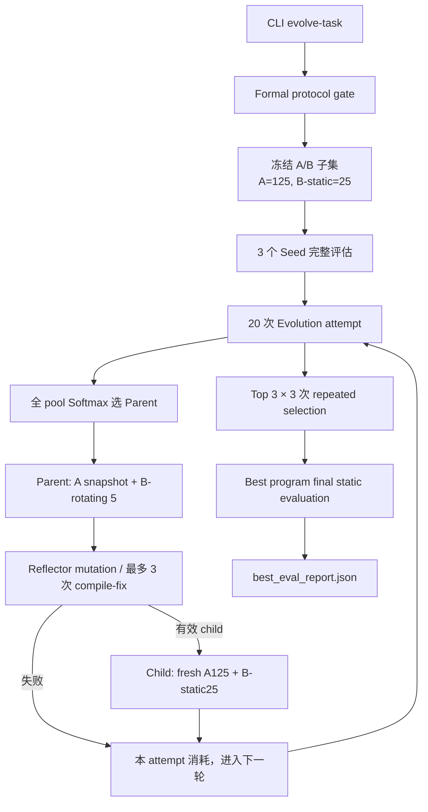
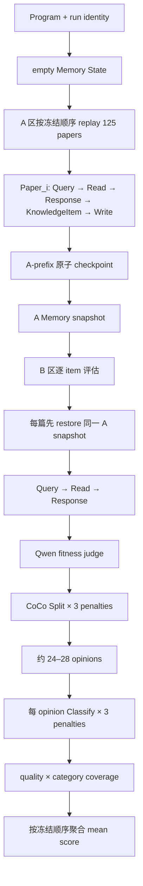

# AgentReview 当前实验进展、运行过慢与实验架构调整报告

> 审计快照：2026-08-27 14:33:59 CST  
> 代码根目录：`/data/xyj/shengao/AgentReview_0811/AgentReview`  
> 当前 run：`runs/formal_qual_seed0_20260825`  
> 分析边界：只读检查活动进程、日志、配置、checkpoint、产物、当前工作树代码和协议文档；未停止、重启或修改当前实验，未运行新的模型评测。  
> 变更边界：本报告是本次唯一新建文件；没有改动已有源码、配置、测试、日志或实验产物。

## 1. 结论摘要

当前正式 QUAL 实验仍在运行，进程和三组模型服务均存活。实验没有卡死，但仍处于初始 Seed 评估阶段，尚未进入 20 次正式 Evolution attempt。

截至快照时：

- `program_000_seed_vector_search` 已完成，static score 为 `0.8572484213`；
- `program_001_seed_llm_summarizer` 已完成，static score 为 `0.8462163346`；
- `program_002_seed_experience_learner` 已完成 125/125 条 A 区 Historical replay，并完成 9/25 条 B 区 static validation，第 10 条正在生成 Review；
- controller 为 `formal-search-controller-checkpoint-v3`，`phase=seeds`、`seed_index=2`、`attempt=0`；
- `evolution_budget.json` 和 `best_eval_report.json` 尚未生成，当前分数不能作为最终 selection、effectiveness 或 official benchmark 结果。

运行慢的首要原因不是单次异常，而是当前实验把多个昂贵步骤完全串行组合后反复执行：

1. 每个完整 Candidate evaluation 都要从 empty state 重放 125 篇 A 区论文，再评估 25 篇 B 区论文；
2. 每篇 B 论文不仅生成 Review，还调用一次 Qwen judge、3 次 CoCo ReviewSplit，并对约 24–28 个 opinion 各执行 3 次 ReviewClassify；
3. 当前适配器逐 opinion、逐 penalty 串行请求，当前 9 篇 B 样本每篇实际产生 72–84 次 Classify；
4. 主 Qwen、Split、Classify 分别占用不同 GPU，但调度器一次只推进一条同步调用链，因此 GPU 0–3 与 GPU 5 呈交替忙碌，未形成流水线；
5. 20 次 evolution、top-3 × 3 次 selection repeat 和 final evaluation 会继续放大同一成本。

最新续跑区间的日志计时显示：CoCo Classify 占已记录阶段耗时约 `55.2%`，Memory Response 占约 `31.7%`，两者合计约 `86.9%`。这说明优化重点应是 evaluator 批处理/流水线和长生成治理，而不是 embedding 或 Python 主进程 CPU。

推荐结论是：**不要改动正在运行的 run；后续新 run 优先重构执行架构，不先改 MSTAR 选择、fitness 或数据协议。** 最优先的结构性调整是建立一个深的 `EvaluationOrchestrator` 模块，在其内部实现 B-case 原子 checkpoint、CoCo Classify 批处理、Qwen/CoCo 跨 GPU 流水线和稳定顺序聚合。

## 2. 审计口径与权威状态

### 2.1 本报告使用的当前证据

运行证据：

- `logs/formal_qual_seed0_20260825.log`
- `runs/formal_qual_seed0_20260825/search_controller_checkpoint.json`
- `runs/formal_qual_seed0_20260825/scores.jsonl`
- `runs/formal_qual_seed0_20260825/candidate_reviews.jsonl`
- `runs/formal_qual_seed0_20260825/checkpoints/*/search-0.json`
- `runs/formal_qual_seed0_20260825/traces/seed_000_static.jsonl`
- `runs/formal_qual_seed0_20260825/traces/seed_001_static.jsonl`
- `/proc` 进程状态和 `nvidia-smi` GPU 快照。

当前协议与实现证据：

- `runs/formal_qual_seed0_20260825/config.json`
- `runs/formal_qual_seed0_20260825/resume.cmd`
- `runs/formal_qual_seed0_20260825/protocol_migration_20260827_mstar_paper_iterations/conversion_audit.json`
- `memory_evolution/search.py`
- `memory_evolution/evaluator.py`
- `memory_evolution/metrics.py`
- `memory_evolution/coco_adapter.py`
- `agentreview/reviewer_runtime/engine.py`
- `agentreview/reviewer_runtime/task_agent.py`
- `agentreview/reviewer_runtime/toolkit.py`。

### 2.2 静态结论与运行时结论的区分

- “调用关系、循环次数、checkpoint 粒度和接口形状”来自当前工作树的静态代码检查；
- “当前阶段、分数、调用次数、阶段耗时、重试次数和 GPU 利用率”来自活动 run 的运行时证据；
- 未进行新的 replay、benchmark、模型 preflight 或性能压测，因此所有预期加速均为待验证方案，不作为已经实现的收益。

### 2.3 当前协议已经从 21-successful 改为 20-attempt

当前实际执行口径不是旧文档中的“21 个 successful children、每 lineage 7 个”，而是与 MSTAR 原论文对齐的 20 个顺序 evolution attempt：

- `memory_evolution/search.py:31-50`：默认 `iterations=20`；
- `memory_evolution/search.py:973-982`：循环以 `attempt >= iterations` 结束；
- `memory_evolution/search.py:1067-1107`：Reflector 失败仍提交当前 attempt；
- `memory_evolution/search.py:1223-1233`：最终写入 `evolution_budget.json`，预算单位是 `evolution_attempt`；
- `conversion_audit.json`：记录从 `successful_children_per_lineage / 21` 到 `evolution_attempt / 20` 的一次性转换，并保存转换前文件 SHA、转换后 SHA、controller identity 和 active Memory snapshot SHA。

转换发生时 controller 仍为 `phase=seeds`、`attempt=0`，仅前两个 Seed 已完成，没有 child program。审计记录显示 static IDs、selected episode IDs、两个 Candidate 状态和 active Seed snapshot 均被保留。因此，当前进度报告按 v3 controller 和当前代码解释。

需要单独记录一个治理风险：`docs/待阅读md/AGENTS.md`、`docs/待阅读md/CONTEXT.md` 和 `docs/adr/0007-evolution-semantics-fresh-state-lineage-budget.md:34` 仍描述旧的 21-successful/equal-lineage 协议，而 `docs/record_ex/MSTAR_PAPER_EVOLUTION_METHOD_20260827.md:95-104` 和当前代码已经改为 20-attempt。该漂移不是本次慢运行的直接原因，但会导致后续报告、恢复操作和论文表述出现口径冲突。

## 3. 当前实验进展

### 3.1 活动进程

| 对象 | PID / 资源 | 快照状态 | 解释 |
|---|---:|---|---|
| formal QUAL 主进程 | PID `342095` | 11:01:40 启动，已运行 3h32m，`S+ / do_poll` | 等待 sandbox/模型调用；不是 CPU 死循环 |
| Candidate sandbox worker | PID `342373` | `pipe_read` | 等待主进程命令，符合 session 协议 |
| Qwen3.8-27B | GPU 0–3 | 快照时四卡均 100% | 正在生成第 10 篇 B Review |
| CoCo ReviewSplit | GPU 4 | 快照时空闲 | 当前尚未进入该篇的 Split 阶段 |
| CoCo ReviewClassify | GPU 5 | 快照时空闲；前一阶段曾约 88% | 与 Qwen 阶段交替工作 |
| Qwen3-Embedding-8B | GPU 6，lazy load | 快照时未占用 | 不是当前主要瓶颈 |
| GPU 7 | 空闲 | 未参与当前栈 | 可作为后续架构实验资源，但不能单卡复制 27B 主模型 |

日志在 14:32:25 更新到新的 `Memory Response START`，进程仍有进展。

### 3.2 Controller 和结果状态

| 字段 | 当前值 |
|---|---|
| controller version | `formal-search-controller-checkpoint-v3` |
| phase | `seeds` |
| seed_index | `2`，即第三个 Seed 正在执行 |
| evolution attempt | `0 / 20` |
| admitted Candidate count | `2` |
| selected A episodes | `125` |
| static B items | `25` |
| `evolution_budget.json` | 尚未生成 |
| `best_eval_report.json` | 尚未生成 |

已完成 Seed：

| Seed | static score | quality | completed evaluation |
|---|---:|---|---|
| `program_000_seed_vector_search` | 0.8572484213 | PASS | 是 |
| `program_001_seed_llm_summarizer` | 0.8462163346 | PASS | 是 |
| `program_002_seed_experience_learner` | 未形成聚合分数 | quality 已启动并通过到 static | 否，9/25 B items 落盘 |

第三个 Seed 的 `checkpoints/program_002_seed_experience_learner/search-0.json` 已记录 `next_paper_index=125` 和 125 个 completed A paper IDs。`candidate_reviews.jsonl` 中该 Seed 已有 9 条完成记录；第 10 条在快照时处于 Qwen `Memory Response`。

### 3.3 不能把当前分数解释成最终实验结果

当前两个分数只用于初始 pool 的 static fitness。尚未发生：

- 20 次 parent selection → rotating evaluation → reflection/mutation → optional child evaluation；
- top-3 Candidate 的 3 次 repeated selection；
- best program final static evaluation；
- C 区 Effectiveness Holdout；
- D 区 Official CoCo Benchmark。

因此当前只能报告“Seed 初始化进度”，不能报告“Evolution 提升”“最佳 Program”或“正式 CoCo 成绩”。

## 4. 当前实验架构

### 4.1 总体控制流



控制器实现集中在 `memory_evolution/search.py:425-1385`。它负责冻结子集、Seed、搜索、selection、final 和 controller checkpoint。

### 4.2 单个 Candidate 的 evaluation



关键实现：

- `memory_evolution/evaluator.py:122-277`：A 区按顺序 self-generated review 后写 Memory，每篇 A 完成后保存 checkpoint；
- `memory_evolution/evaluator.py:277-285`：每篇 B 都恢复同一个 A snapshot，B item 之间在语义上独立；
- `agentreview/reviewer_runtime/engine.py:122-158`：单篇 Review 是 `Query → KnowledgeBase.read → Response`；
- `agentreview/reviewer_runtime/task_agent.py:151-196`：KnowledgeItem、Query、Response 都是独立主模型调用；
- `memory_evolution/metrics.py:195-314`：先执行 Qwen judge，再执行 candidate category classification，最后求 fitness；
- `agentreview/reviewer_runtime/toolkit.py:574-598`：classification 固定为 Split 后 Classify；
- `memory_evolution/coco_adapter.py:253-317`：一个 Review 串行执行 3 个 Split penalty；
- `memory_evolution/coco_adapter.py:319-363`：每个 opinion 串行执行 3 个 Classify penalty。

### 4.3 模块、接口、接缝与适配器

| 模块 | 当前接口 | 实现职责 | 设计判断 |
|---|---|---|---|
| Search Controller | `run_evolution(...) -> EvolutionResult` | Seed、20 attempts、selection、final、controller resume | 行为很多但外部接口小，是较深模块；性能调度仍直接内嵌 |
| Evaluator | `evaluate_program(...) -> EvalResult` | fresh A replay、B reset、Review、metric、资源统计 | 核心语义集中正确，但同步循环把执行策略与实验语义绑在一起 |
| Reviewer runtime | `ReviewerSession.review/ingest/snapshot/restore` | sandbox 内 MemoryProgram 执行 | 是清晰接缝；适合被新的 orchestrator 复用 |
| Metric | `CoCoReviewFitness(prediction, gold, item)` | Qwen judge、category coverage、fitness | 接口小，但 implementation 内的两个独立远程分支被强制串行 |
| CoCo adapter | factory 返回 `(splitter, classifier)` | 冻结模型 revision、prompt、解析、penalty ensemble | 当前接口偏浅；调用方仍需知道 Split→Classify 组合关系 |
| Model clients | OpenAI-compatible sync call | Qwen、Split、Classify 推理 | 只有同步 request 接口，没有 batch/queue/backpressure |
| Artifact/checkpoint | JSON/JSONL 文件 | A-prefix、controller、score、trace | A 恢复粒度好；B 缺少 per-item 原子恢复 |

已有的 `ReviewerSession` 和 Benchmark Adapter 思路是合适的接缝。需要调整的是 Evaluator 内部的执行架构，不需要改变 MemoryProgram、MSTAR parent selection 或 fitness 公式。

## 5. 工作量放大分析

### 5.1 一次完整 evaluation 的基础成本

对 vector-search / experience-learner 一类没有额外 `read()` LLM 的 Program：

- 每篇 A：`Memory Query + Memory Response + Memory KnowledgeItem`，至少 3 次 Qwen；
- 每篇 B：`Memory Query + Memory Response + fitness judge`，至少 3 次 Qwen；
- 每篇 B：3 次 CoCo Split；
- 每篇 B：`3 × opinion_count` 次 CoCo Classify。

LLM Summarizer 的 `KnowledgeBase.read()` 还会增加一次 Qwen 调用。因此 3 次只是下界，进化后的 Candidate 也可在受控接口内增加一次 read/write LLM。

当前 9 个完成 B case 的 Classify 次数依次为：

`72, 81, 78, 81, 81, 78, 75, 84, 81`

平均为 79 次，对应约 24–28 个 opinion，每个 opinion 运行 3 个 penalty。

### 5.2 整个当前配置的放大公式

令 `S` 为 20 次 attempt 中通过 quality 并完成 static evaluation 的 child 数，`0 <= S <= 20`。

完整 `A125 + B25` evaluation 数量为：

`3 Seed + S child + 3 top-k × 3 selection repeats + 1 final = 13 + S`

此外每个 evolution attempt 都会先做一次 parent 的 B-rotating 5；其 A snapshot 可通过相同 Candidate/replicate checkpoint 恢复，但仍要重新评估 5 个 B item。

| 工作量 | 公式 | S=0 | S=20（所有 child 有效） |
|---|---:|---:|---:|
| 完整 evaluation | `13 + S` | 13 | 33 |
| A paper replay | `125 × (13 + S)` | 1,625 | 4,125 |
| B paper evaluation | `25 × (13 + S) + 5 × 20` | 425 | 925 |
| Qwen 核心调用下界 | `3 × (A + B)` | 6,150 | 15,150 |
| CoCo Split | `3 × B` | 1,275 | 2,775 |
| CoCo Classify，按实测 72–84/B | `B × [72,84]` | 30,600–35,700 | 66,600–77,700 |

上述尚未加入 Reflector、compile-fix、Candidate 内额外 toolkit LLM、截断/空响应重试和失败 attempt 的额外成本。

因此，“iterations=20”不等于 20 次模型调用，也不等于 20 × 25 个简单样本；真正控制墙钟的是数万次 evaluator 请求和数千次长上下文主模型生成。

### 5.3 Selection 尾部成本容易被忽略

`memory_evolution/search.py:1236-1305` 会对 static score 排名前 3 的 Candidate 各执行 3 个 selection replicate；`memory_evolution/search.py:1333-1340` 又对最佳 Program执行一次 final evaluation。

由于 replicate ID 不同，每个 replicate 都有独立 checkpoint identity，当前实现会重新构建该 Program 的 A125 Memory，再跑 B25。即使 evolution loop 已经结束，尾部仍有 10 次完整 evaluation。这不是日志“卡住”，而是配置明确要求的额外实验工作量。

## 6. 运行时性能证据

### 6.1 最新续跑区间的阶段计时

统计区间从日志最后一次：

`[MSTAR] Seed program_002_seed_experience_learner: static evaluation started`

开始，到 2026-08-27 14:33 快照。该区间先从 A checkpoint 的 114/125 恢复并补完剩余 11 篇 A，然后完成 9 篇 B，第 10 篇正在执行。

| 阶段 | 已完成调用 | 累计秒数 | 单次均值 | 已记录阶段耗时占比 |
|---|---:|---:|---:|---:|
| Memory Query | 21 | 475.3 | 22.6 | 3.8% |
| Memory Response | 20 | 3,999.1 | 200.0 | 31.7% |
| Memory KnowledgeItem | 11 | 258.6 | 23.5 | 2.0% |
| Memory Harness / judge | 9 | 712.3 | 79.1 | 5.6% |
| CoCo Split | 27 | 213.9 | 7.9 | 1.7% |
| CoCo Classify | 711 | 6,971.7 | 9.8 | 55.2% |
| 合计 | — | 12,630.9 | — | 100% |

阶段累计时间约 3h30m31s，与进程墙钟 3h32m 接近。这说明这些阶段基本是首尾相接的串行执行，Python 调度和文件 I/O 不是主要空洞。

### 6.2 已完成 Seed 的 B-case 用时

- `seed_000_static.jsonl`：25 个 read case 全部成功，mean duration `924.06s`，约 15.4 分钟/篇；
- `seed_001_static.jsonl`：25 个 read case 全部成功，mean duration `976.43s`，约 16.3 分钟/篇。

仅 B25 static evaluation 就约需 6.4–6.8 小时；这还不包含该 Candidate 首次 A125 replay。

### 6.3 GPU 利用模式证明存在流水线空缺

两个连续快照呈现明显的阶段交替：

- CoCo Classify 阶段：GPU 5 约 84–88%，GPU 0–4 基本空闲；
- 下一篇 Memory Response 阶段：GPU 0–3 均 100%，GPU 4–5 空闲。

这与同步代码路径一致：下一篇 Qwen 生成必须等待上一篇全部 CoCo Classify 完成。当前资源不是“所有 GPU 同时不足”，而是“每个阶段都只使用自己的 GPU，阶段间没有重叠”。

### 6.4 重试与历史中断

最新续跑区间：

- 3 次 `[TRUNCATED RESPONSE]`；
- 2 次 `[EMPTY RESPONSE][MAX_COMPLETION_TOKENS EXHAUSTED]` 后恢复；
- 0 个新的 Traceback、API FAILED、timeout 或 embedding cache miss。

整个 run 的旧日志包含更早的 sandbox `MemoryError`、多次长度耗尽和一次 `KeyboardInterrupt`。当前 `--sandbox-memory-mb` 已提高为 8192 MiB，当前进程没有新的硬失败。旧中断仍说明 B 区缺少 per-item resume 时，长评估容易产生重复工作风险。

## 7. 可能原因：按证据排序

### 原因 1：CoCo Classify 的 opinion × 3 penalty 串行扇出

置信度：高。

证据：

- `memory_evolution/coco_adapter.py:319-363` 是双层同步循环；
- 当前 9 篇 B case 每篇 72–84 个 Classify 请求；
- 711 次已完成 Classify 占最新阶段累计时间 55.2%；
- Classify 使用 `enable_thinking=True` 和 `max_tokens=12288`。

可证伪预测：对相同冻结 review、prompt、模型 revision 和 penalty 集合，若改为有界并发/批处理后标签集合与 fitness 完全一致而墙钟显著下降，则该原因成立；若吞吐不升，说明单卡已被 token 生成完全饱和，需要先做服务容量调整。

### 原因 2：跨 GPU 阶段没有流水线

置信度：高。

证据：

- `memory_evolution/evaluator.py:281-408` 按 B item 串行；
- `memory_evolution/metrics.py:208-210,289-303` 先 Qwen judge、后 CoCo category classification；
- Qwen 和 CoCo 使用不同 GPU，却在快照中交替忙碌；
- 阶段累计时间几乎等于墙钟，说明没有有效重叠。

可证伪预测：若从同一 A snapshot 创建隔离的 B worker，并让 `Review(n+1)` 与 `Classify(n)` 重叠，在输出保持一致时墙钟应趋近较慢 stage 的时间，而不是各 stage 时间之和。

### 原因 3：fresh-state A replay 和 selection repeats 的结构性放大

置信度：高。

证据：

- ADR-0007 与 `memory_evolution/evaluator.py:122-277` 要求每个 Program 从 empty state 重放 A；
- 每个有效 child 都需要新的 Program-specific A snapshot；
- top-3 × 3 selection 和 final 共增加 10 次完整 A125+B25 evaluation；
- full-run 上界为 4,125 篇 A replay 和 925 篇 B evaluation。

可证伪预测：完整资源账本中的 A paper count 应按 `125 × (13+S)` 近似线性增长。若不符合，应检查 checkpoint 命中率或是否存在未记录的 snapshot 复用。

这部分有两类不同问题：Candidate 间不共享 A Memory 是方法学硬约束，不能为了速度取消；相同 Program 的 selection replicate 是否必须重放 A，则取决于 selection 想测“完整 pipeline 噪声”还是“evaluator 噪声”，属于协议决策，不能静默优化。

### 原因 4：Qwen 长 Response 与 8192→16384 重试

置信度：高。

证据：

- 当前 Memory Response 单次均值约 200 秒，占 31.7%；
- 当前配置 `max_tokens=8192`、`retry_max_tokens=16384`；
- 日志存在 length/empty response 后的整次重试，单次完成曾达到约 419 秒；
- Qwen 服务以 `--max-num-seqs 1` 运行，长请求会独占主模型队列。

可证伪预测：以 prompt chars、completion tokens、是否 retry 为自变量建立 case-level latency 表，Response 延迟应与 completion tokens/retry 强相关。若相关性弱，应进一步检查 vLLM 调度或网络等待。

### 原因 5：B evaluation 缺少 per-item 原子 checkpoint

置信度：高；它主要放大失败/中断成本，不解释无中断时的基础速度。

证据：

- A 区每篇保存 checkpoint；
- B 区只在内存中累计 `scores/evaluated_cases`，完成整个 `evaluate_program` 后才返回；
- controller 只提交完成的 Seed/Candidate，不记录 Seed 内已完成的 B prefix；
- `candidate_reviews.jsonl` 会逐篇追加，但它不构成可恢复的 metric checkpoint。

可证伪预测：在隔离测试 run 的第 k 个 B item 后中断，再恢复；当前实现会重新执行之前的 B item。增加 identity-bound per-item commit 后，恢复应只执行未完成 item，最终顺序和 mean score与无中断运行一致。

### 原因 6：当前 evaluator 并发能力远低于原论文工程配置

置信度：中高。

`docs/record_ex/MSTAR_PAPER_EVOLUTION_METHOD_20260827.md:88-93` 记录原论文配置为 64 evaluator workers；当前 `evaluate_program`、CoCo Split 和 CoCo Classify 均为同步循环。模型、数据和 evaluator 任务更重，不能直接预期 64 倍加速，但“原论文工作量设计依赖并行 evaluator、当前实现完全串行”是重要架构差异。

## 8. 建议的目标实验架构

### 8.1 核心设计：深的 EvaluationOrchestrator 模块

建议把 `evaluate_program` 中的“实验语义”和“同步执行方式”拆开，在 Reviewer runtime 与 Metric 之上建立一个深模块：

```text
EvaluationOrchestrator.evaluate(
    program_identity,
    historical_spec,
    validation_spec,
    metric_identity,
    run_identity,
) -> EvalResult
```

调用者只需理解上述接口及以下不变量：A 顺序、B 从相同 A snapshot 开始、输出按冻结 item 顺序聚合、错误/恢复语义、资源预算。并发队列、批处理、重试、per-item checkpoint、backpressure 和阶段 telemetry 都隐藏在 implementation 内。

这个模块的删除测试成立：若删除它，并发、顺序、恢复、缓存身份和资源治理会重新散落到 Search、Evaluator、Metric、CoCo adapter 和脚本中。因此它能提供真实的深度与 locality，而不是再加一层 pass-through。

### 8.2 目标数据流

```mermaid
flowchart LR
    Controller[Search Controller] --> Orchestrator[EvaluationOrchestrator]
    Orchestrator --> ABuilder[A Replay Builder\n严格顺序]
    ABuilder --> Snapshot[(Identity-bound A Snapshot)]
    Snapshot --> BQueue[B Item Queue\n冻结顺序 + bounded concurrency]
    BQueue --> Sessions[隔离 Reviewer Sessions]
    Sessions --> QwenQ[Qwen generation queue\nGPU 0-3]
    QwenQ --> Fork{Review ready}
    Fork --> JudgeQ[Judge queue\nGPU 0-3]
    Fork --> SplitQ[Split queue\nGPU 4]
    SplitQ --> ClassifyQ[Classify batch queue\nGPU 5]
    JudgeQ --> Join[Case result join]
    ClassifyQ --> Join
    Join --> CaseStore[(Per-case atomic store)]
    CaseStore --> Ordered[Stable-order aggregator]
    Ordered --> Result[EvalResult + resource ledger]
```



重要约束：

- A 内部不能并行，因为 `Paper_i` 必须只读 `Paper_1..Paper_{i-1}`；
- B item 可以并行，因为代码已规定每篇从相同 A snapshot 恢复；
- 每个 B worker 必须拥有隔离的 sandbox/session，不能共享可变 Memory State；
- Judge 和 category classification 对同一个已生成 Review 相互独立，可并发；
- 最终结果必须按 frozen B ID 顺序聚合，而不是按完成顺序；
- prompt、penalty、模型 revision、temperature、parser 和 fitness 公式不变时，调度变化可以作为 execution-only 优化验证。

### 8.3 建议形成的接缝与适配器

| 接缝 | 建议接口 | 生产适配器 | 测试/验证适配器 |
|---|---|---|---|
| Candidate execution | `open/restore/review/snapshot/close` | 现有 bubblewrap `ReviewerSession` | in-process deterministic fake |
| Model generation | `submit(request) -> future/result` | OpenAI-compatible bounded queue | captured-response replay |
| Review taxonomy | `classify(review, identity) -> result` 或 batch 版本 | Frozen CoCo adapter | sequential reference/replay adapter |
| Case artifact store | `load/commit(case_identity)` | atomic JSONL/SQLite | in-memory store |
| Telemetry | `record(stage_event)` | JSONL + aggregate report | in-memory collector |

当前 CoCo factory 只返回两个 callables，只有一个 production adapter 时接缝仍偏假设性。加入“现有 sequential reference adapter”和“新的 batched adapter”后，才形成可做 differential verification 的真实接缝。

## 9. 调整方案分级

### 9.1 A 级：不改变实验语义，优先实施

#### A1. B-case 原子 checkpoint

每完成一个 B item，原子写入：

- run identity、Program SHA、A snapshot SHA；
- eval item ID、frozen index；
- candidate review SHA；
- judge/category structured result；
- score、资源和 stage timing；
- metric/model/prompt revision identity。

恢复时只接受严格匹配 identity 的已完成 case，并按 frozen order 聚合。它主要减少中断重算和 duplicate artifact，不改变 fitness。

#### A2. CoCo Classify 有界批处理

保持每个 opinion 的三组 penalty、prompt、temperature、revision 和解析逻辑不变，把一篇或多篇 Review 的 Classify 请求提交为有界并发批次。输出按 `(paper_index, opinion_index, penalty_index)` 排序后执行现有选择规则。

上线前必须用已完成 candidate reviews 做 sequential-vs-batched differential replay：标签集合、N/A 处理、coverage 和最终 fitness 必须一致。

#### A3. B-item 跨 GPU 流水线

使用 2–4 个隔离 B worker 起步，令：

- GPU 0–3 生成下一篇 Review；
- GPU 4 对上一篇执行 Split；
- GPU 5 对更早一篇执行 Classify；
- 主进程按 frozen index join 结果。

并发上限必须由显存、vLLM queue latency 和 sandbox 内存共同控制，不能直接照搬原论文 64 workers。

#### A4. Judge 与 category classification 并发

Review 生成完成后，Qwen judge 和 CoCo classification 是两个独立分支。即使暂不实现多 B worker，也可先并发这两个分支，再 join fitness。这是较小的执行重构。

#### A5. Workload planner 与 stage telemetry

在 run 启动前生成 `workload_plan.json`，明确：

- 预计完整 evaluation、A/B paper 数；
- Qwen/Split/Classify 调用下界；
- selection/final 尾部成本；
- 按实测 p50/p90 的预计墙钟区间。

日志事件加入 `run_id / candidate_id / replicate_id / paper_id / stage / attempt / tokens / elapsed`。这样进度可以由 committed work 而不是日志行数判断。

### 9.2 B 级：基础设施调整，需要等价性和容量验证

#### B1. 调整 Qwen vLLM 并发能力

当前主服务使用 `--max-num-seqs 1`，且 `--max-model-len 262144`、显存利用率 0.95。可以在独立性能 run 中测试较小的实际 context 上限与 `max-num-seqs > 1`，换取 KV cache 并发能力。

这不能直接应用到当前 run：服务配置属于已记录的 runtime identity；调整后需要新的 run identity，并验证输出协议、OOM 风险和吞吐。

#### B2. CoCo 服务容量测试

GPU 5 在单请求流中已达到较高利用率，批处理是否提升吞吐不能只靠推测。应固定一组 captured opinions，测量 sequential、concurrency 2、4、8 的：

- opinions/second；
- tokens/second；
- p50/p95 latency；
- peak memory；
- label/fitness equality。

选择吞吐拐点作为 queue 上限。

#### B3. 独立阶段队列与 backpressure

不能无界生成 Review 堆积到 GPU 5。Orchestrator 应以 Classify queue 深度反压 Qwen generation，防止主存、日志和 sandbox 数量失控。

### 9.3 C 级：会改变实验协议，只能作为新 ablation

以下调整会改变 metric、噪声定义或搜索语义，不能在当前 formal run 中静默替换：

- Classify 从 3 个 penalty 降为 1 个；
- `CLASSIFY_ENABLE_THINKING=True` 改为 False；
- 更换较小的 judge、task model 或 CoCo classifier；
- 减少 static 25、rotating 5、A budget 125；
- 减少 selection top-k 或 selection repeats；
- selection repeat 复用同一 A snapshot 或同一生成 Review；
- 只对高分 child 做 static25 的 multi-fidelity promotion；
- Candidate 继承父代 Memory State；
- 用便宜 proxy fitness 替换当前正式 fitness。

其中“Candidate 继承父代 Memory”与 ADR-0007 的归因原则直接冲突，不建议作为当前 MSTAR 主实验优化。其他方案可建立独立 ablation，必须使用新 config identity、run directory 和方法说明，不能续接当前 controller。

## 10. 推荐实施顺序与验收信号

### 阶段 0：保持当前 run 不动

- 继续只读监控当前进程；
- 记录最终 Seed 3 完成时刻；
- 不在活动进程加载的源码、服务参数或产物上做热修改；
- 当前 run 若自然完成，保留为 serial reference baseline。

### 阶段 1：先补恢复与可观测性

1. 实现 B per-item checkpoint；
2. 实现统一 stage event schema 和 workload planner；
3. 在隔离小规模 run 中验证中断后不重算已提交 B item；
4. 验证无中断与恢复运行的 candidate review SHA、case score、mean score 一致。

### 阶段 2：替换 CoCo 内部执行实现

1. 保留现有 sequential adapter 作为 reference；
2. 新增 batched adapter；
3. 对 captured reviews 做标签和 fitness differential；
4. 只有完全等价后，才把 batched adapter用于新的 formal run。

### 阶段 3：建立 B pipeline

1. 一个 A snapshot；
2. 两个隔离 B worker 起步；
3. stable-order join；
4. 逐步提高并发并观察 GPU、OOM、queue time；
5. 用相同 frozen inputs 对照 serial reference。

### 阶段 4：再决定是否做协议 ablation

若执行优化后仍无法接受，再把“单 penalty、thinking off、selection repeats、proxy/multi-fidelity”等作为单独研究问题。报告这些结果时必须明确它们回答的是 performance–quality tradeoff，而不是原 formal 配置的直接替代。

## 11. 对当前完成时间的判断

按已完成 Seed 的 B-case 均值 15.4–16.3 分钟，第三个 Seed 剩余 16 个 B item 仍约需 4–5 小时，长 Response/重试会进一步拉长。完成第三个 Seed 后才开始 20 次 Evolution attempt。

全 run 的完成时间不能由“20 iterations”直接外推。若大部分 mutation 成功并触发 child A125+B25，随后再执行 9 次 selection repeat 和 1 次 final，当前完全串行架构很可能需要多日到一周以上。该区间是基于当前实测吞吐和调用倍率的工程估计，不是完成承诺。

## 12. 最终建议

1. 当前 run 继续保持不动，把它作为真实 serial baseline；
2. 把 CoCo Classify 串行扇出认定为第一瓶颈，把长 Memory Response 认定为第二瓶颈；
3. 优先建立 `EvaluationOrchestrator`，先解决 B checkpoint、批处理、流水线和 telemetry；
4. 保留 A fresh-state、B snapshot reset、MSTAR 20-attempt、softmax parent selection、fitness 和 Frozen CoCo prompt/revision；
5. 将任何减少 penalty、关闭 thinking、减少数据规模、复用 replicate A snapshot或更换模型的方案单列为新 ablation；
6. 尽快统一 ADR/AGENTS/CONTEXT 与当前 20-attempt v3 实现，避免协议解释继续漂移。

目前最值得调整的不是实验研究逻辑，而是 evaluator execution architecture。当前代码已经具备 A snapshot 和 B item 独立性的正确语义基础，缺少的是一个能把这些性质转化为可靠并行、可恢复执行的深模块。

## 附录 A：关键证据位置

| 主题 | 路径 / 代码位置 |
|---|---|
| 当前完整启动参数 | `runs/formal_qual_seed0_20260825/resume.cmd` |
| controller v3 | `runs/formal_qual_seed0_20260825/search_controller_checkpoint.json` |
| 协议转换审计 | `runs/formal_qual_seed0_20260825/protocol_migration_20260827_mstar_paper_iterations/conversion_audit.json` |
| 当前分数 | `runs/formal_qual_seed0_20260825/scores.jsonl` |
| 活动日志 | `logs/formal_qual_seed0_20260825.log` |
| Search 总控制流 | `memory_evolution/search.py:425-1385` |
| 20 attempt loop | `memory_evolution/search.py:973-1233` |
| selection 和 final | `memory_evolution/search.py:1236-1377` |
| A replay / B reset | `memory_evolution/evaluator.py:122-285` |
| B Review/metric loop | `memory_evolution/evaluator.py:281-451` |
| Reviewer runtime | `agentreview/reviewer_runtime/engine.py:32-207` |
| Query/Response/KnowledgeItem prompts | `agentreview/reviewer_runtime/task_agent.py:151-196` |
| CoCo fitness | `memory_evolution/metrics.py:119-314` |
| Split/Classify adapter | `memory_evolution/coco_adapter.py:253-363` |
| 分类调用入口 | `agentreview/reviewer_runtime/toolkit.py:574-598` |
| fresh-state 方法约束 | `docs/adr/0007-evolution-semantics-fresh-state-lineage-budget.md:1-45` |
| 当前 20-attempt 方法核对 | `docs/record_ex/MSTAR_PAPER_EVOLUTION_METHOD_20260827.md:1-104` |

## 附录 B：附属实验状态

IDE 中打开的 `/tmp/agentreview-c10-meta-ablation.RXAjY5/coco_meta_off.log` 对应 C10 META ablation，已于 2026-08-26 完成并保存 `evaluation.json`。它不是当前 formal QUAL 进程，也不影响上述进度与瓶颈判断。
