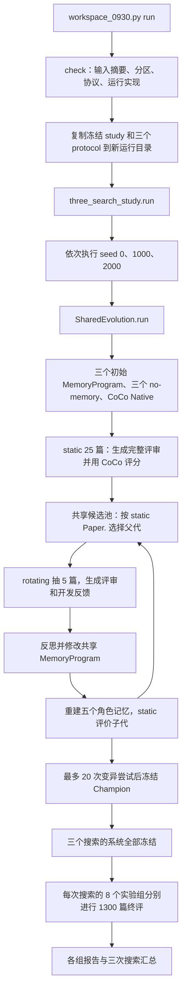
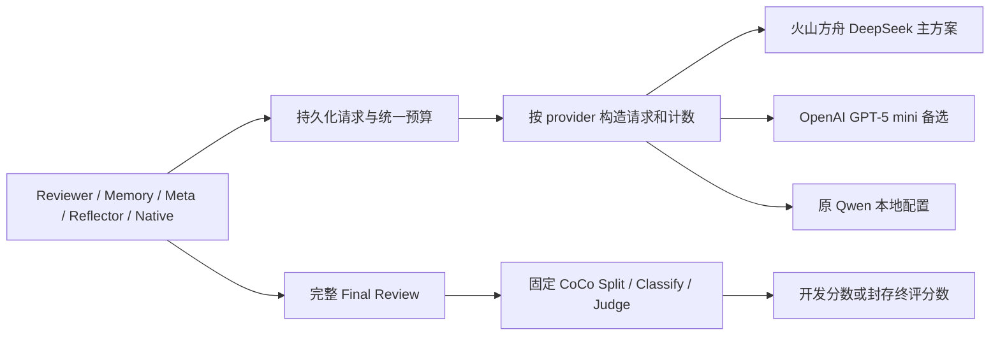

> 实施更新：本方案已按后续用户要求收敛为方舟 DeepSeek API。CoCo 原文的 GPT-5-Mini Judge 也已替换为 DeepSeek；原 Split/Classify 保留。当前配置、代码清理范围和验证结果以 README.md、docs/API_ADAPTATION_0930.md 为准，下面是实施前的方案记录。

# AgentReview 0930 运行逻辑与火山方舟 DeepSeek 适配方案

核验日期：2026-09-29。检查对象：`/data/xyj/shengao/AgentReview_0930`，分支 `0930`，HEAD `2057c99014e4a43e9356b1bcaf37e5dd5e7012f4`。检查开始时 Git 工作区干净。

按本次最新选择，主目标为火山方舟 **DeepSeek-V4.1-Flash**，GPT-5 mini 作为备选。本文是当前源码检查和待实施方案；没有修改运行代码、冻结配置或数据，没有调用付费模型，没有启动服务或实验。

**结论：可以接入，但不能只替换 base_url 和 model。** 0930 目前把本地 Qwen 的模型身份、分词、限流、CoCo Native 对照和实验冻结绑定在一起。建议先完成“云端生成 + 现有本地 CoCo 评分”，让审稿、记忆操作、反思、Meta 和 Native 对照都使用同一个云端生成配置，评分模型保持一致。

**一、这次实际验证了什么**

执行了现有检查入口：

```bash
cd /data/xyj/shengao/AgentReview_0930
/data/xyj/envs/coco-original/bin/python -B deployment/workspace_0930.py check
```

结果为 `passed`：3192 个本地输入文件、1575 篇完整论文、3 份协议；build/static/rotating/sealed_test 分别为 125/25/125/1300。旧版本文件读取次数 0、模型调用次数 0；服务检查标记为 `false`。

此外，用内存中的配置副本做了无网络验证：把模型换成其他模型会被 `_validate_model()` 拒绝；在当前执行配置下使用云端地址会被 `slot_for()` 拒绝。这些检查未改写配置。

当前环境 `coco-original` 中 `openai==2.6.0`，SDK 已包含 `reasoning_effort`、`max_completion_tokens`、`response_format` 参数；`tiktoken` 未安装。没有为这次检查安装依赖。检查时本目录没有 `artifacts/`。

GitNexus 当前只登记了 AgentFlow，没有 0930 的索引，因此本报告的调用关系来自直接读源码，未借用其他仓库的图谱。README/`metadata/validation.json` 记录的迁移测试基线为 464 passed、214 subtests passed、36 failed、9 skipped；**这是已有记录，本次没有重跑全量测试，也没有证明这些失败已修复。**

**二、0930 的实际运行流程**

0930 是从 0915 当前工作区建立的独立基线。数据已收进本目录，但 CoCo 源码、Python 环境和部分模型安装仍是公共依赖。入口及主要调用如下：



图中循环受失败预算约束，可能暂停或有界提前结束；20 次是 mutation attempt 上限，不保证得到 20 个有效新程序。三次搜索按入口中的循环顺序执行，并非三组同时训练。

| 阶段 | 源码入口 | 具体行为 |
|---|---|---|
| 独立输入检查 | [workspace_0930.py](deployment/workspace_0930.py)，`check()` 第 36 行 | 校验文件摘要、正文保持、分区、本地路径和 runtime 身份；不探测模型服务。 |
| 运行编排 | 同文件 `run()` 第 79 行；[three_search_study.py](deployment/three_search_study.py) 第 107 行 | 默认写入 `artifacts/study-0930/`，逐组执行搜索，全部冻结后才进入终评。 |
| 构建经验 | [shared_experiment.py](AgentReview/agentreview/research_v2/shared_experiment.py)，`_bootstrap()` 第 195 行 | 对 build 125 篇运行五角色无记忆审稿，形成自己的历史评审经验；同一 epoch 可复用已完整持久化的结果。 |
| 构建候选记忆 | 同文件 `assess()` 第 262 行；[memory.py](AgentReview/agentreview/research_v2/memory.py) | 每个候选用同一程序，分别创建 QUAL/CLAR/SIGN/ORIG/POL 的独立记忆快照。 |
| 单篇审稿 | 同文件 `_generate_paper()` 第 345 行 | 各角色读取自己的 Memory，完成专门评审，再由 Meta 汇总 Final Review。当前每篇内部五角色依次执行，配置允许两篇并行。 |
| 开发评分 | [development_coco.py](AgentReview/agentreview/research_v2/development_coco.py)、[development_coco_worker.py](AgentReview/agentreview/research_v2/development_coco_worker.py) | 调用原 CoCo 的 Split、Classify、指标/Judge 评价；以完整 Final Review 的 Table-1 `Paper.` 作为搜索分数。 |
| 共享进化 | [shared_evolution.py](AgentReview/agentreview/research_v2/shared_evolution.py)，`SharedEvolution.run()` 第 315 行 | 合格 seed/子代进入共享池；正温度 softmax 选父代，static 分数维护 Champion。 |
| 程序反思 | `shared_experiment.py` 的 `propose()` 第 483 行 | 使用 rotating 的完整评分与轨迹；目前选最低分的 2 个案例作详细反馈，保留 5 篇概览；返回 change 和完整 Python 程序。 |
| 冻结后终评 | 同文件 `run_shared_final_test()` 第 699 行 | 校验系统、生成实现与实验身份，复用冻结记忆，对八组进行 sealed_test 评价；结果不回流搜索。 |

三个起始程序是 `vector_search`、`llm_summarizer`、`experience_learner`。每次搜索的终评组为：三个 seed、各自的三个 no-memory 对照、一个 CoCo Native、一个 Champion，共八组。五角色是固定职责，**共享的是记忆程序代码，不是共享可变记忆内容，也不是训练模型权重**。Meta 是固定汇总组件，不是第六个进化角色。

当前配置还固定：S2 off、Memory-only 变异、父代选择温度 0.6、生成温度 0、Qwen thinking off。父代选择温度属于搜索算法，与 API 的生成温度是两回事。现有基准保留历史使用注释，不应改称完全未见的盲测集。

单次生成的现有链路为：

```text
LocalSharedBackend.client()
  → PersistentCompletionClient.complete()
      → 写入请求身份并预留 attempt
      → count_chat_tokens() 做输入/上下文预算检查
      → OpenAICompletionClient.complete()
          → request_slot() 限流
          → OpenAI SDK chat.completions.create()
          → 必须恰好一个 choice、finish_reason=stop、content 非空
      → 保存原始 completion、用量和可复用结果
```

当前最大请求尝试数为 3，SDK 自动重试关闭；候选修复 1 次、累计修复上限 10、候选失败上限 5、连续失败 3 次触发诊断暂停。云端接入应保留完整输出和有限失败处理的原则。

**三、火山方舟的接入目标**

你给的是[方舟模型详情页](https://ark.volcengine.com/region:cn-beijing/model/detail?name=deepseek-v4-1-flash)。该控制台动态页本次未能读取；以下模型和接口信息核对自官方公开文档的可检索内容，不代表已验证你账号的开通权限。

| 项目 | 主方案 |
|---|---|
| provider（拟新增配置值） | `volcengine_ark` |
| SDK | 继续使用 Python OpenAI SDK 的 Chat Completions 接口 |
| base_url | `https://ark.cn-beijing.volces.com/api/v3` |
| 正式 Model ID | `deepseek-v4-1-flash-260910`；如账号使用接入点，则填绑定该模型版本的实际 `ep-...` |
| API Key 环境变量 | `ARK_API_KEY`，只保存环境变量名，不将密钥写入协议 |
| 首个适配档建议 | 显式关闭 thinking，保留原生成温度 0，先验证现有流程 |

公开模型列表列出了上述 Model ID 和 1024k 上下文；Chat API 支持 Model ID 或 Endpoint ID。不要直接把详情页 query 参数当作可调用 ID，也不要混用 Coding Plan 的模型别名和地址。[方舟模型列表](https://docs.volcengine.com/docs/ark/model-list?lang=zh)、[Chat API](https://docs.volcengine.com/docs/ark/chat-api?lang=zh)。

方舟 DeepSeek-V4.1-Flash 支持 `thinking.type=enabled/disabled`，默认为开启。需要思考时可单独建立 `reasoning_effort=low` 的新档位；首轮不传两套可能冲突的思考控制字段。[深度思考参数](https://docs.volcengine.com/docs/ark/deep-thinking?lang=zh)。

其 `max_tokens` 包含思考和回答的总输出预算；也支持 `max_completion_tokens`，两者不能同时发送。这里建议 Ark 分支先使用明确的 `max_tokens`，并沿用业务层预算入口，不依赖服务默认输出上限。[Chat API 输出参数](https://docs.volcengine.com/docs/ark/chat-api?lang=zh)。

下面只是传输层调用示意，尚未并入 0930，也未执行。它不替代实验入口中的记账、分词、完整性和冻结检查：

```python
import os
from openai import OpenAI

client = OpenAI(
    api_key=os.environ["ARK_API_KEY"],
    base_url="https://ark.cn-beijing.volces.com/api/v3",
    max_retries=0,
    timeout=180.0,  # 初始联通测试值，长论文需测量后冻结超时策略
)
response = client.chat.completions.create(
    model="deepseek-v4-1-flash-260910",
    messages=[{"role": "user", "content": "请用一句话说明论文审稿的目的。"}],
    temperature=0.0,
    max_tokens=1024,
    extra_body={"thinking": {"type": "disabled"}},
)
choice = response.choices[0]
if choice.finish_reason != "stop" or not (choice.message.content or "").strip():
    raise RuntimeError("模型没有返回完整回答")
print(choice.message.content)
```

实际组件的输出预算仍需单独指定，不能统一改成示例里的 1024。思考开启后，即使请求成功，也可能因推理消耗预算导致最终正文或程序不完整；必须检查结束原因并保留原始响应。

**四、为什么现有代码不能只换地址**

| 当前约束与位置 | 直接替换后的问题 | 拟修改方式 |
|---|---|---|
| [experiment_protocol.py](AgentReview/agentreview/research_v2/experiment_protocol.py):181，`_validate_model()` | 必须是 `qwen3.8-27b` / `Qwen/Qwen3.8-27B`，且地址必须为本地；云模型在发请求前就被拒绝。 | 引入有版本的 provider schema；旧 Qwen 校验保留，新云配置校验 provider、模型、接口、计数策略与参数能力。 |
| [config.py](AgentReview/agentreview/research_v2/config.py):22，`ModelConfig` | 强制带本地 precision、vLLM、tokenizer/chat-template SHA；不认识 provider 或 reasoning 配置。 | 分开公共模型身份与本地部署身份；云端不伪填 Qwen 的 revision、BF16 或 tokenizer 摘要。 |
| [llm.py](AgentReview/agentreview/research_v2/llm.py):174，`complete()` | 每次发送 `temperature`、`max_tokens` 和 Qwen 专用 `chat_template_kwargs`。 | 按 provider 构造请求：Ark 用其 `thinking`；GPT 用自己的输出和推理参数；本地分支保持兼容。 |
| 同文件第 133 行，`count_chat_tokens()` | 去掉 `/v1` 后拼接 `/tokenize`，要求返回 `count/max_model_len`；Ark 的 `/api/v3` 也会被错误拼接。 | 引入 provider 对应的 TokenCounter；不能把 SDK 协议兼容理解成分词接口相同。 |
| [shared_experiment.py](AgentReview/agentreview/research_v2/shared_experiment.py):146，`memory_runtime()` | 从 **评分 Judge** 的模型目录取 tokenizer，但 SHA 来自 **生成模型**；换模型后会错配。 | 记忆计数器随生成 profile 绑定，独立于评分模型；同步修改 `reviewer_runtime/memory_budget.py`。 |
| [request_admission.py](AgentReview/agentreview/research_v2/request_admission.py):14、68 | 只接受三个固定端口，且只允许 `127.0.0.1`；云地址直接报错。 | 新执行协议按服务名/provider/model 管理并发及 RPM/TPM；保留本地三个服务的限流。 |
| [coco_native.py](AgentReview/agentreview/research_v2/coco_native.py):101，`_request()` | Native 对照再次要求本地 Qwen；只修五角色审稿仍无法完成八组实验。 | 保留 Native prompt 与解析器，改用新模型身份；分离 prompt 的 `no_think` 语义和供应商 API 参数。 |
| [experiment_requests.py](AgentReview/agentreview/research_v2/experiment_requests.py):32 | 已有有限重试，但无云限流退避；身份未显式表达完整的供应商参数。 | 纳入规范化有效请求参数、计数器和 provider 身份；增加 Retry-After/退避、请求 ID 与用量记账。 |
| [three_search_study.py](deployment/three_search_study.py):107 | 删除所有代理环境变量，依赖本地 lease/监控；冻结果校验实现摘要。 | 按 provider 配置网络行为；仅本地调用绕过代理；云端不申请 Qwen lease；扩展 telemetry。 |
| [workspace_0930.py](deployment/workspace_0930.py):14、79 | 写死 `config/0930` 与 `artifacts/study-0930`，检查旧冻结身份。 | 入口支持显式配置/输出根，建立新 profile 的冻结链，继续拒绝错误 resume。 |

还有两个容易漏掉的记录点：`review.py::specialist_generation_identity()` 和 `meta.py::generate_final_review()` 目前会补默认 `temperature/enable_thinking`。适配后要记录真实生效的 decoding 配置，不能请求里开启推理、产物却写 thinking off。新增 adapter/token-counter 模块还需加入 `runtime_identity()`、`generation_identity()` 的摘要覆盖范围。

**五、推荐的模块边界与配置方案**

保持 `CompletionClient.complete(messages, max_tokens, component, response_format)` 的业务接口，继续复用现有角色、MemoryProgram、搜索和评分流程。在它下面加入供应商请求构造和计数策略，而不是在每个角色里分别写 API 调用。



建议采用三个独立 profile：原 `0930`、新 `0930-ark-deepseek-v41`、可选 `0930-openai-gpt5-mini`。各自拥有 config、experiment_id、study_id、run_root、候选池、生成缓存、检查点和冻结记录。共享只读论文输入可以保留，模型变化时不复用旧生成结果或旧 winner。

以下是**拟新增配置结构的局部示意，当前 ModelConfig 不能直接读取**：

```json
{
  "provider": "volcengine_ark",
  "api": "chat_completions",
  "base_url": "https://ark.cn-beijing.volces.com/api/v3",
  "api_key_env": "ARK_API_KEY",
  "model": "deepseek-v4-1-flash-260910",
  "decoding": {
    "temperature": 0.0,
    "thinking": {"type": "disabled"},
    "output_limit_field": "max_tokens"
  },
  "token_accounting": {
    "provider": "ark_deepseek_v41",
    "validation_status": "pending"
  }
}
```

`validation_status=pending` 的 profile 必须阻止正式运行。拟新增字段是本项目配置，不是把整个对象传给 API。若使用 Endpoint ID，额外冻结它指向的模型版本；不能只记录一个以后可能重新绑定的 `ep-...`。云模型不提供本地权重摘要，实验报告应如实区分云服务版本记录和本地权重字节冻结。

**分词和预算必须单独适配。**

- 完整请求：Ark 提供 `/api/v3/tokenization`，输入是 text 或 text 列表，不是现有 vLLM 的完整 chat payload。官方接口示例不足以证明该模型已支持此端点，需用目标 Model ID 实测；文本 token 数也不自动包含消息边界和 JSON schema 开销。[方舟分词 API](https://docs.volcengine.com/docs/ark/tokenization-api?lang=en)。
- 若目标支持官方分词，缓存相同文本结果，并将消息模板等额外开销计入请求预算；用真实响应 `usage.prompt_tokens` 校准。如果使用本地 DeepSeek tokenizer，必须先验证版本、特殊 token 与方舟服务一致，不能继续使用 Qwen tokenizer。
- Memory 条目选择需要频繁调用同步 `count_tokens(text)`，应采用已验证的本地计数器或宿主缓存；模型密钥与网络能力留在宿主，不能交给候选 Python 程序。读取仍只选完整条目，不能截断经验文本来凑预算。
- 无法精确计数时，可提出明确记录的保守估算策略及安全余量，但它改变现有计数保证，必须作为新协议评审和验证，不能伪装成精确 token 数或静默取消预算检查。
- 当前输入预算 114688；review/native 输出 8192，memory 4096，Meta/reflection 16384。首轮不因模型上下文较大就扩大所有预算；先验证最长论文、五角色结果组合后的 Meta 输入、反思程序输出是否完整，再冻结新值。

**限流、失败与成本。**

云端并发建议从 1–2 个 in-flight 请求做兼容性验证，正式上限按账号实际 RPM/TPM 和长论文 token 消耗确定，不照搬端口 18001 的 16 槽。共享配额应覆盖不同角色和进程。SDK 保持 `max_retries=0`，由持久化请求层统一处理 429/超时/5xx 的有限退避；鉴权和非法参数错误应尽早失败。不得失败后悄悄切换另一模型。

记录每个组件的输入、输出、缓存命中和可用的 reasoning token 用量、请求 ID、时延、结束原因；推理字段不能拼入正式评审正文。只有完整、解析通过的结果才能进入 Memory、CoCo 或候选池。流式支持若后续加入，也应在完整结束后才提交成功产物。

完整实验规模远大于一次聊天：三次搜索的终评共有 `3 × 8 × 1300 = 31200` 份 Final Review。按七个五角色加 Meta 组、一个 Native 组计算，终评主生成流程名义调用量为 `3 × 1300 × (7 × 6 + 1) = 167700` 次；还没计 Memory、bootstrap、开发搜索、反思、CoCo 或重试，也未扣除可能的复用。应以独立 smoke 的实测用量估算全程费用和耗时。

**六、CoCo 评分要不要也切到云端**

推荐第一阶段保持下列职责分工：

| 用途 | 建议模型/服务 |
|---|---|
| 五角色、build 经验、Memory 内部生成、Meta、Reflector、Native 对照 | 同一个 Ark DeepSeek profile |
| CoCo Split | 当前 Qwen3-8B-Split |
| CoCo Classify | 当前 Qwen3-8B-Classify |
| CoCo Judge | 当前冻结的本地 Qwen3.8-27B |
| embedding | 当前 Qwen3-Embedding-8B；配置 device 为 cpu |
| BERTScore | 当前冻结本地模型缓存 |

这样能检验“生成模型变化后的系统表现”，同时保持评分口径可比。云端审稿不等于实验不再需要本地模型服务。

如果目标还包括去掉本地 Qwen Judge，则是第二阶段：`development_coco.py::_validate_config()` 强制本地评分服务与 Qwen Judge；`development_coco_worker.py::_service_ready()` 检查本机端口/PID/模型路径，`_client()` 写死本地鉴权；`coco_integrity.py::_token_budget()` 也调用 `/tokenize`。这些都需 provider 分支。CoCo 上游 `_4_evaluation.py`/`src/utils.py` 还有自己的参数构造，不能认为改本项目 `llm.py` 会自动覆盖 Judge。

建议在本项目 worker/adapter 层适配并保留原始评分算法，不直接批量改共享 CoCo 仓库。更换 Judge 后应重新冻结 scoring_config 和全部评分身份、重新评分比较组；不把新 Judge 的分数直接与旧 Judge 的历史分数混合选优。Split/Classify 是专门模型，也不应因换生成 API 顺带替换。

**七、GPT-5 mini 的备选差异**

如果后续仍要保留 GPT 选项，复用上述边界，另建 `openai` profile：`base_url=https://api.openai.com/v1`、`model=gpt-5-mini`、`api_key_env=OPENAI_API_KEY`。它支持 Chat Completions、结构化输出，公开上下文为 400000；具体账号权限仍需实测。[GPT-5 mini 模型文档](https://developers.openai.com/api/docs/models/gpt-5-mini)。

GPT 分支使用 `max_completion_tokens` 和模型支持的 `reasoning_effort`，首个测试档可设 `low`；不要发送现有 `temperature=0`、`top_p`、Qwen 的 `chat_template_kwargs` 或 Ark 的 `thinking`。GPT-5 mini 的推理档位与后续 GPT 型号不同，不能把新型号的 `none` 支持套用过来。[GPT-5 指南](https://developers.openai.com/api/docs/guides/latest-model?model=gpt-5)、[参数兼容说明](https://developers.openai.com/api/docs/guides/latest-model?model=gpt-5.2)。

`max_completion_tokens` 包含推理消耗，并非最终可见正文的专用额度。[Chat Completions API](https://developers.openai.com/api/reference/resources/chat/subresources/completions/methods/create)。

计数可采用经过校准的固定版本本地 tokenizer 加消息开销估算；若要求服务器精确请求计数，可另评估 Responses 适配。官方输入计数端点对应 Responses payload，不能未经验证就称为 Chat Completions 的精确计数。[OpenAI token 计数文档](https://developers.openai.com/api/docs/guides/token-counting)。

**八、实施顺序和验收标准**

以下均为待实施工作。本次没有生成能直接启动云端正式实验的 frozen 配置。

1. **建立新协议与 provider 配置。** 修改 `config.py`、`experiment_protocol.py`，补充模型能力校验；原 Qwen 协议和新 Ark 协议各有兼容边界。新建独立 config/run 根，避免把旧冻结文件当作可编辑模板原地覆盖。
2. **完成请求和计数闭环。** 修改 `llm.py`、`experiment_requests.py`、`request_admission.py`；完成目标模型分词验证、完整响应、JSON 解析、云配额和退避处理。远程缺少密钥时本地报错，不能使用 `local-not-required` 继续请求。
3. **覆盖全部生成路径。** 接通 `memory_runtime()`、`memory_budget.py`、Native 对照以及 review/meta 的身份记录。保留五角色、Meta、Memory-only 变异、输入正文和 CoCo 算法边界。
4. **改造入口与冻结工具。** `workspace_0930.py` 支持新配置和运行根；`three_search_study.py` 按 provider 处理代理、服务与监控。旧 `paired_benchmark_budget.py` 写死 Qwen tokenizer，旧 freeze 工具依赖历史产物，不应直接套用；新增或参数化预算/冻结流程。
5. **完成离线回归和小规模真实闭环。** 先验证 payload、鉴权失败、429、超时、空响应、length、损坏 JSON、计数超限和恢复隔离，再执行独立开发 smoke。不要调用现有 `workspace_0930.py run` 来做小样本测试，它会进入完整三次搜索。
6. **冻结并执行正式实验。** 实测通过后，按依赖顺序生成计数/能力与验证凭据 → 新执行配置 → 三份新 protocol → 新 study。更新引用 SHA、runtime/generation 身份和所有输出路径；保留三组全冻结后终评的顺序。

| 验收范围 | 通过条件 |
|---|---|
| 旧协议兼容 | 原 Qwen 输入检查仍通过；区分既有失败与新增失败，未扩大原基线失败集合。 |
| 请求适配 | Ark 请求无 Qwen 私有参数；目标模型 ID、输出上限、thinking 配置和鉴权正确。 |
| 计数与输入 | 普通/最长论文、Memory、Meta、Reflector 均有明确计数依据及预算；无正文静默裁剪。 |
| 生成覆盖 | 五角色、Meta、三种 MemoryProgram、Reflector 完整代码生成与 Native 对照都能完成。 |
| 最小端到端 | 独立开发样本完成经验构建 → 角色快照 → Final Review → CoCo 完整评分 → 一次合法变异/子代评价；有完整 receipts。 |
| 故障恢复 | 429 等按配额退避；重启复用已完整请求；不复用其他模型结果，不用失败样本补零。 |
| 正式冻结 | 三组协议身份不同但条件匹配；所有系统冻结后才进入终评；新增 adapter 文件包含在实现摘要中。 |

依赖建议放在新的生成运行环境中验证，保留评分子进程使用已冻结的 `coco-original`。评分配置绑定 Python 包版本，直接在共享评分环境中升级 SDK 或安装新依赖可能使其身份失效。

本次交付完成的是：当前运行逻辑、已验证的本地基线、云端适配阻碍、逐文件方案和验收路线。仍待实施的是 provider/计数/限流改造、新协议冻结以及真实 API 与 CoCo 闭环验收。
